<div align="center">


# Cyberdog

**Tous vos serveurs SSH dans une seule belle fenêtre.**<br>
Une alternative moderne et rapide à Cyberduck : explorateur SFTP, terminal intégré, tableau de bord de santé des serveurs et scripts en un clic — pour macOS et Windows.


[English](README.md) · **Français**

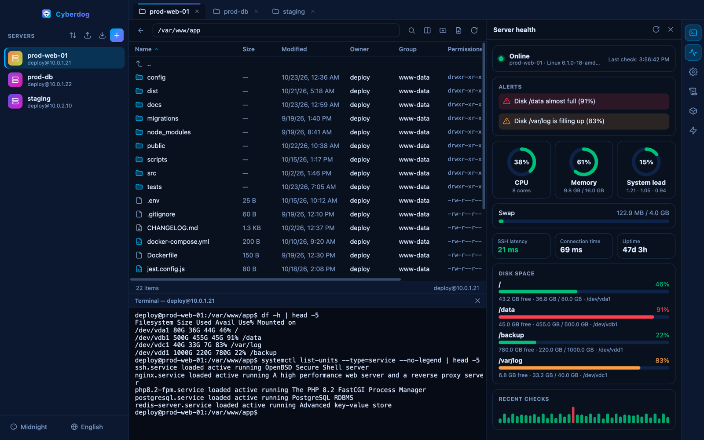

</div>

---

## En développement : équipes avec licence Premium

La version de développement propose une activation par email d’achat et clé de licence, sans compte ni code email. Une licence active permet de créer des équipes et de partager des serveurs ; les invitations utilisent un identifiant de membre. Le serveur vérifie la licence et les permissions à chaque opération. Les mots de passe et clés SSH restent locaux. La préversion 1.7.0-beta.2 inclut cet aperçu Premium en mode Test ; la vente commerciale n’est pas encore ouverte.

## Nouveautés de 1.7.0-beta.2

- Modules Premium privés : espace personnel, équipes, serveurs et groupes/actions/chemins partagés, permissions et restauration des versions.
- Dix connecteurs de coffres locaux, dont TeamPass, Keeper Secrets Manager, Password Manager Pro, Devolutions Server et RDM sous Windows. Voir les [prérequis et limites](docs/secret-vaults.md).
- Paramètres avec navigation à gauche, fond adapté au thème, logos des coffres et icône Enregistrer.
- Le Premium est un aperçu en mode Test. Le cœur open source reste gratuit ; les modules propriétaires sont assemblés depuis le dépôt privé.

## Nouveautés de la version 1.6.3

Le panneau de droite peut être réduit jusqu’à 290 px (environ 60 % de l’ancienne largeur minimale). Glissez sa bordure gauche pour le redimensionner ; la largeur choisie est mémorisée.

## Nouveautés de la version 1.6.2

- **Restauration facultative de la session :** activez **Rouvrir les connexions au démarrage** dans Paramètres → Général pour rouvrir les onglets serveurs et terminaux laissés ouverts à la fermeture. L’option est décochée par défaut et aucune commande n’est rejouée. Seules les références aux serveurs configurés et la présence du terminal sont enregistrées. Les serveurs supprimés sont ignorés et désactiver l’option efface la session mémorisée.
- **Chemins partagés :** la fenêtre d’enregistrement propose **Disponible sur tous les serveurs**, décochée par défaut depuis l’explorateur. Cochez-la pour partager le chemin ; sinon, il reste associé au serveur courant. Ce choix peut aussi être modifié sur un chemin existant.
- **Nouveau site web :** présentation, captures et téléchargements macOS / Windows sur [pickywawa.github.io/cyberdog](https://pickywawa.github.io/cyberdog/). Le site est disponible en français et anglais, adapté au mobile, avec une galerie interactive et le respect des préférences de réduction des animations.

## ✨ Pourquoi Cyberdog ?

| | |
|---|---|
| 📁 **Un vrai explorateur de fichiers** | Naviguez sur un serveur comme dans un dossier local : colonnes triables (nom, taille, date, propriétaire, groupe, permissions, type, extension), glisser-déposer depuis le bureau, actions au clic droit, **recherche distante instantanée**, **vue scindée** et **désarchivage** en un clic. |
| 🖥️ **Terminal inclus** | Un clic ouvre un terminal SSH *sous* l'explorateur, déjà placé dans le dossier que vous parcourez. Fini la jonglerie entre fenêtres. |
| 📈 **La santé du serveur d'un coup d'œil** | En ligne/hors ligne, CPU, RAM, charge, disques avec alertes, uptime et latence SSH. |
| ⚙️ **Services, logs et Docker** | Démarrez/arrêtez/redémarrez les services `systemctl`, suivez en direct `journalctl`, Nginx ou vos logs applicatifs (filtres par niveau, erreurs en évidence, recherches favorites), gérez vos conteneurs Docker (logs en direct, CPU/RAM, démarrage/arrêt) et inspectez les images. |
| ⚡ **Actions rapides** | Enregistrez vos scripts bash une fois, lancez-les sur un serveur — ou sur **tous les serveurs ouverts** — en un clic. |
| 🔁 **Partagez votre configuration** | Export ZIP sélectif des groupes, serveurs, actions et chemins. Import de configuration, **Cyberduck**, **FileZilla XML** et **WinSCP INI**. |
| 🎨 **Pensé pour être beau** | 7 thèmes, 4 langues, barres de défilement discrètes, autant d'onglets de serveurs que vous voulez. |

---

## ⚙️ Paramètres

Le bouton **Paramètres** à côté de la langue — ou **Cyberdog → Paramètres…** sur macOS — regroupe la langue, le thème, l'éditeur par défaut et les mises à jour. Vous pouvez aussi choisir un dossier de configuration externe pour partager serveurs, groupes, actions rapides, chemins enregistrés et recherches favorites, tout en gardant les préférences personnelles sur chaque poste.

La taille, la position et l’état maximisé de la fenêtre sont restaurés au lancement suivant. Si un écran est débranché, la fenêtre revient sur un écran disponible.

La case facultative **Rouvrir les connexions au démarrage** restaure les onglets serveurs et terminaux laissés ouverts à la fermeture. Elle est décochée par défaut. Seules les références aux serveurs et la présence d’un terminal sont enregistrées ; aucune commande n’est rejouée.

Un double-clic sur un fichier l'ouvre dans l'éditeur choisi et chaque enregistrement le renvoie sur le serveur.

---

## 📦 Installation

Téléchargez le dernier installeur depuis la **[page des Releases](https://github.com/pickywawa/cyberdog/releases/latest)**.

Cyberdog affiche sa version près du logo et signale les nouvelles versions avec un badge animé **Nouveau**. Sur Windows (installation classique), cliquez dessus pour télécharger puis installer la mise à jour et relancer l'app. Sur macOS, une fois le DMG téléchargé, Cyberdog propose de l’ouvrir puis de quitter automatiquement pour vous permettre de glisser la mise à jour dans Applications et de relancer l’app. « Plus tard » conserve l’app ouverte et le DMG téléchargé pour une installation ultérieure. Si le DMG ne peut pas être ouvert, Cyberdog reste lancé. La version Windows portable télécharge et ouvre son exécutable.

Les recherches et téléchargements de mises à jour utilisent le réseau natif d’Electron pour respecter le proxy système, y compris les configurations d’entreprise PAC/WPAD.

### macOS (Apple Silicon et Intel)

1. Téléchargez `Cyberdog-<version>-mac-arm64.dmg` (Apple Silicon : M1/M2/M3/M4) ou `Cyberdog-<version>-mac-x64.dmg` (Intel).
2. Ouvrez le `.dmg` et glissez **Cyberdog** dans **Applications**.
3. Premier lancement : l'app n'est pas encore notarisée, macOS peut donc la bloquer. Faites **clic droit → Ouvrir → Ouvrir**, ou exécutez une fois :
   ```sh
   xattr -dr com.apple.quarantine /Applications/Cyberdog.app
   ```

### Windows (10 / 11, 64 bits)

- **Installeur** : `Cyberdog-Setup-<version>-x64.exe` — choix du dossier d'installation, raccourcis menu Démarrer et bureau.
- **Portable** : `Cyberdog-<version>-portable-x64.exe` — sans installation, à lancer depuis n'importe où (clé USB, dossier partagé…).

> Au premier lancement, Windows SmartScreen peut signaler un éditeur inconnu (l'app n'est pas encore signée) : cliquez sur **Informations complémentaires → Exécuter quand même**.

Chaque release contient aussi un fichier `SHA256SUMS.txt` pour vérifier votre téléchargement.

---

## 🚀 Visite guidée

### Exporter et importer la configuration

Le bouton **Exporter la configuration** ouvre une sélection par catégories : groupes (s’il y en a), serveurs, actions rapides et chemins enregistrés. Toutes les catégories sont cochées et repliées au départ. Dépliez-les pour sélectionner chaque élément ; la case de la catégorie permet de tout cocher ou décocher.

Le ZIP contient un `manifest.json` et les dossiers `groups/`, `servers/`, `actions/` et `paths/`, avec un JSON par élément sélectionné. Les mots de passe, empreintes d’hôte et fichiers de clés privées sont exclus. Les scripts sont exportés tels quels.

**Importer → Configuration ZIP** restaure les catégories en une opération et accepte aussi les anciens ZIP de serveurs ou d’actions. L’import fusionne sans écraser les identifiants de connexion existants. Les associations des chemins sont rétablies même si les identifiants internes des serveurs diffèrent. Pour exporter uniquement des chemins propres à un serveur, celui-ci doit déjà exister dans la configuration de destination ; les chemins sans serveur correspondant sont ignorés et comptés dans le résultat.

Le menu conserve **Cyberduck** et ajoute les exports SFTP de **FileZilla** (`sitemanager.xml` ou export XML) et **WinSCP** (export INI via [Outils → Exporter/Sauvegarder la configuration](https://winscp.net/eng/docs/config)). Les mots de passe de ces logiciels ne sont pas importés. Les formats Transmit et SolarWinds ne sont pas encore pris en charge.

Les chemins enregistrés sont conservés dans le dossier de données utilisateur, indépendant de la version de l’app. Les écritures sont atomiques et une copie `paths.json.bak` permet de récupérer le dernier état valide si le fichier principal devient illisible. Un dossier externe indisponible reste configuré et déclenche un message, sans basculer silencieusement vers un autre dossier.

### Ouvrez vos serveurs au simple clic

Cliquez sur un serveur (ou appuyez sur Entrée lorsqu’il a le focus) pour l’ouvrir. Un Cyberdog animé et le texte « Ouverture… » apparaissent au centre du panneau principal pendant la connexion.

Ajoutez un serveur avec un nom, un hôte, un login et un mot de passe (ou utilisez votre agent / clé SSH). Réorganisez-les par glisser-déposer, triez de A à Z et **importez tout depuis Cyberduck** en un clic. La page d'accueil vous guide parmi les options.

Gardez une longue liste lisible : **groupes** repliables (l'état est mémorisé d'un lancement à l'autre), **favoris** (★ sur un serveur ou un groupe entier : ils remontent en tête sous un séparateur *Favoris*), **recherche en direct** (🔍) qui filtre serveurs et groupes pendant la frappe, et **Dupliquer** dans le menu clic droit pour créer un serveur pré-rempli à partir d'un autre. Glissez un serveur sur un groupe pour l'y ranger.

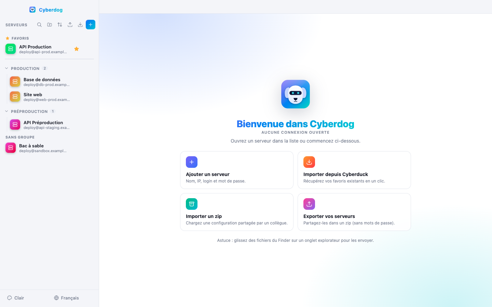

Le menu clic droit permet aussi de dupliquer un serveur : les champs sont préremplis, sans créer de connexion ni recopier son identifiant.

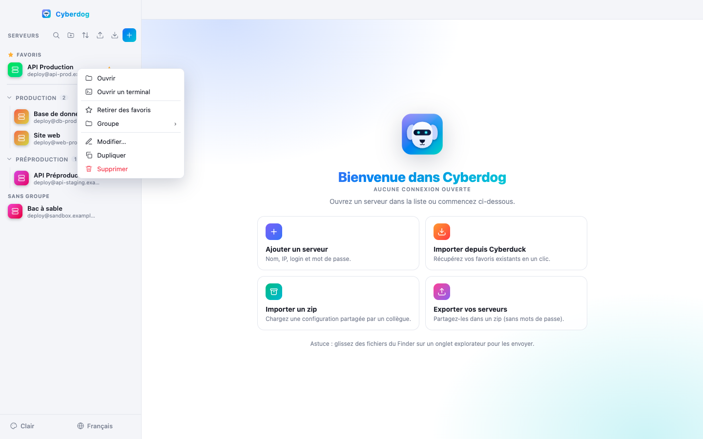

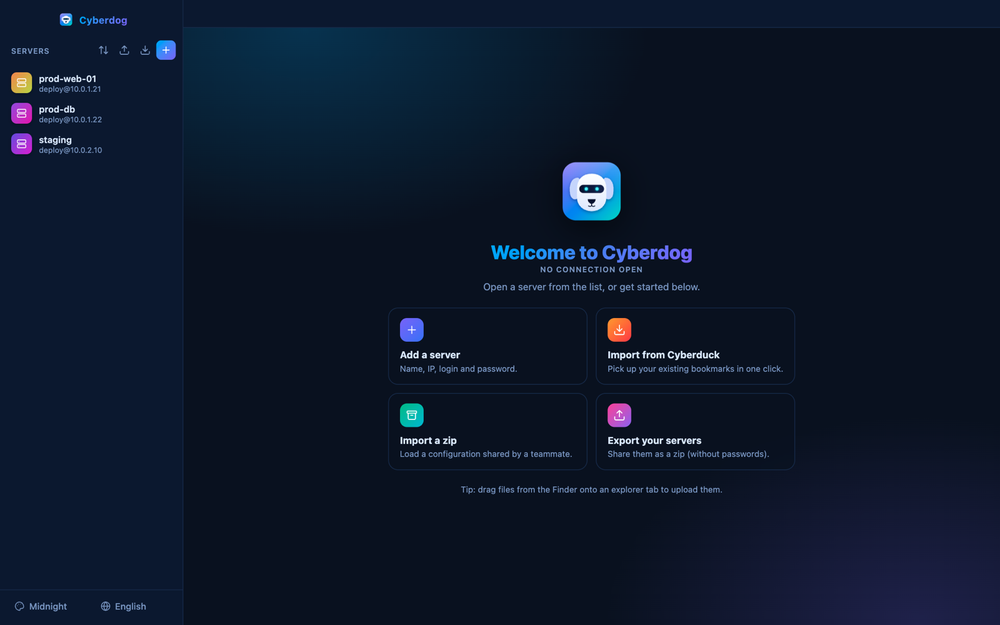

### Un explorateur de fichiers moderne

Dossiers d'abord, icônes colorées selon le type de fichier, sélection multiple (⌘/Ctrl-clic, Maj-clic) et un menu clic droit : *Télécharger sous…, Copier le nom, Copier le chemin complet, Éditer avec…, Désarchiver, Renommer, Supprimer, Nouveau dossier, Nouveau fichier*.

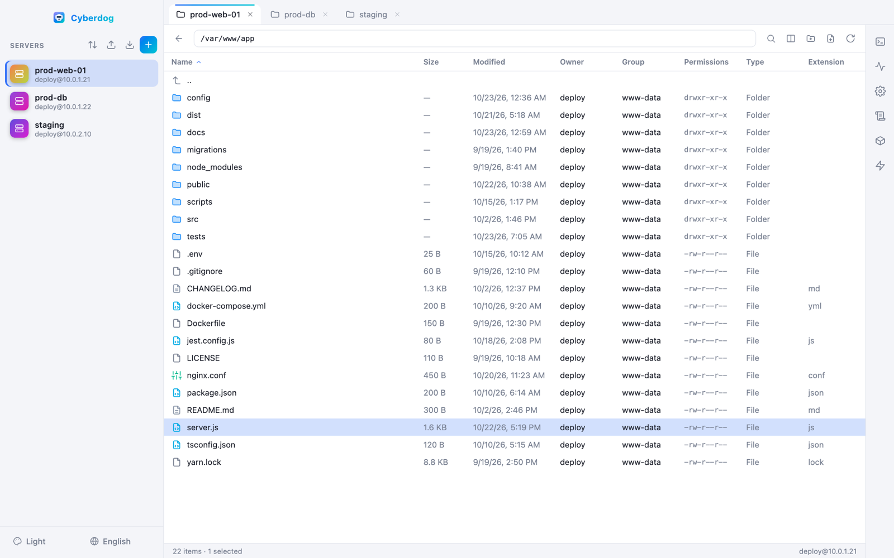

**Éditer avec…** télécharge le fichier, l'ouvre dans VS Code, Cursor, Sublime Text, Notepad++, TextEdit… (ce qui est installé) et **le renvoie sur le serveur à chaque enregistrement**.

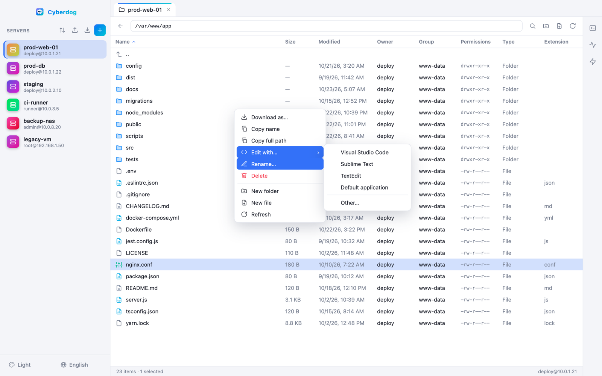

**Chemins enregistrés** : le bouton 🔖 dans la barre de chemin déroule vos dossiers favoris (par serveur ou pour tous) — un clic et l'explorateur s'y rend. Gérez-les depuis le bouton 🔖 de la barre d'outils de droite.

**Recherchez sur le serveur** (🔍 ou ⌘/Ctrl-F) : tapez quelques lettres, obtenez des suggestions en direct — dans le dossier courant ou sur tout le serveur — et allez directement dans le dossier parent du fichier, déjà sélectionné.

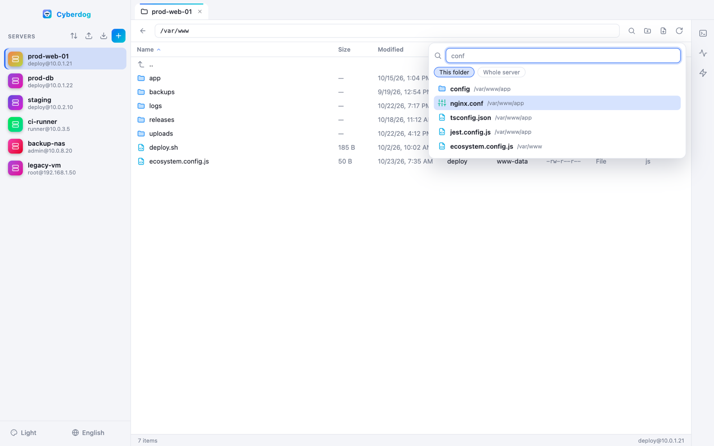

**Désarchivez sur place** : clic droit sur un `.zip`, `.tar.gz`, `.tgz`, `.tar.bz2`, `.tar.xz`, `.7z`, `.rar`, `.gz`… puis *Désarchiver ici* ou *Désarchiver dans « nom/ »* — l'opération s'exécute sur le serveur, rien n'est téléchargé.

**Vue scindée** : le bouton ⧉ de la barre de l'explorateur le scinde en **deux explorateurs indépendants** (chemin, historique, sélection, tri et recherche propres) pour comparer des dossiers ou travailler à deux endroits en même temps. Glissez des fichiers d'un côté à l'autre pour les copier, même entre dossiers distants. Recliquez sur ⧉ pour fusionner.

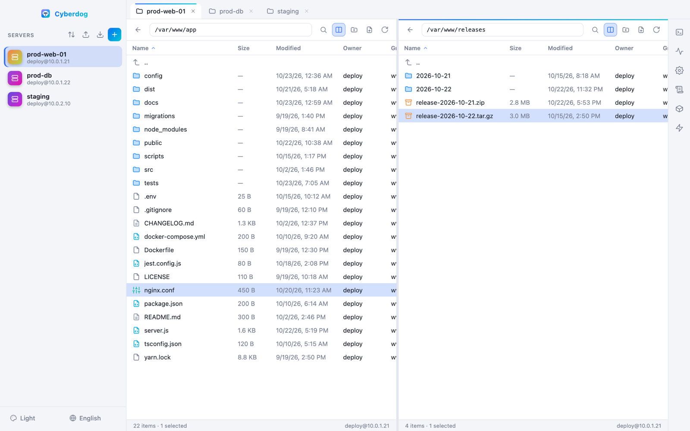

**Glisser-déposer** : déposez des fichiers du bureau pour les envoyer (dossiers compris), ou glissez des fichiers de Cyberdog vers votre bureau pour les télécharger.

**Tout est redimensionnable** : tirez le bord de la liste des serveurs, du panneau de droite, du terminal ou la séparation entre les deux explorateurs. Les tailles sont mémorisées.

### Permissions et propriétaire

Dans le menu clic droit d’un fichier ou dossier, **Modifier les permissions…** affiche le propriétaire actuel et permet de choisir un autre compte du serveur. Le mode octal (`0644`, `0755`…) est synchronisé avec les cases **Lecture / Écriture / Exécution** pour le propriétaire, le groupe et les autres. Les bits spéciaux `setuid`, `setgid` et `sticky` sont aussi disponibles.

Le groupe du fichier est conservé. Les modifications utilisent les droits du compte SSH ; un changement de propriétaire refusé ou une modification partiellement appliquée est signalé.

### Le terminal, là où vous travaillez

Le terminal s'ouvre sous l'explorateur, démarre dans le dossier courant et reste ouvert quand vous changez de panneau. Un splitter permet de le redimensionner.

### Tableau de bord de santé

Cliquez sur le bouton 📈 de la barre d'outils de droite (terminal, santé, services, logs, Docker et actions rapides s'y trouvent). Toutes les 10 secondes :

- Statut **en ligne / hors ligne** et heure de la dernière vérification
- **CPU, mémoire, swap et charge système**
- **Espace disque par volume** avec avertissement à 80 % et alerte critique à 90 %
- **Uptime, latence SSH et temps de connexion**, avec l'historique des dernières vérifications

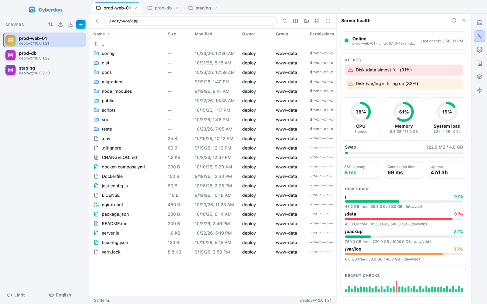

### Process Explorer

La vue **Process Explorer** à droite affiche les processus Linux via SSH, sans agent. Actualisation toutes les 5 secondes, recherche et regroupements par programme, arbre parent/enfants, utilisateur, service systemd ou conteneur. Les tendances CPU/mémoire reposent sur les mesures observées, jusqu’à 5 minutes, avec alertes de pics CPU, croissance mémoire, zombies et attentes d’E/S.

Les détails à la demande présentent les ports écoutés, le dossier et la commande. Un diagnostic local aide à comprendre le programme. Le menu contextuel donne accès aux logs, au terminal SSH et aux arrêts **SIGTERM / SIGKILL**, avec confirmation. Les données disponibles dépendent des permissions ; Linux `/proc` et `procps` sont requis, `ss` sert aux ports et le journal systemd aux logs.

Les panneaux de droite sont redimensionnables avec une largeur minimale de **290 px**, mémorisée pour les prochains lancements.

### Certificats SSL et clés SSH

La barre tout à droite peut être **dépliée ou repliée** pour afficher les titres des vues ; ce choix est mémorisé.

**Certificats SSL** recherche via SSH les certificats PEM/DER dans les dossiers Let’s Encrypt, nginx, Apache et `/etc/pki/tls/certs`, ou dans un dossier absolu de votre choix. OpenSSL doit être disponible sur le serveur. La vue affiche les domaines, l’émetteur, les fichiers, l’empreinte SHA-256 et les dates de validité. Les doublons sont regroupés par empreinte. Une recherche limitée est signalée pour permettre de cibler un dossier plus précis.

Les alertes sont réglables à **7, 14, 30, 60 ou 90 jours** avant échéance, avec un état distinct pour les certificats expirés ou pas encore valides. L’analyse se renouvelle chaque minute lorsque la vue est ouverte ; les alertes du dernier résultat apparaissent aussi dans le tableau de santé. Il n’y a pas de surveillance lorsque l’app est fermée. La case **Utiliser sudo** permet d’accéder aux dossiers protégés selon les droits du compte connecté.

Le bouton **Renouveler avec Certbot** est disponible pour les certificats gérés dans `/etc/letsencrypt/live` lorsque Certbot est installé. Il utilise la configuration et les hooks existants, sans forcer un renouvellement avant l’échéance prévue par Certbot. Le résultat de la commande est affiché, puis les dates sont actualisées. Voir la [documentation Certbot](https://eff-certbot.readthedocs.io/en/stable/using.html#renewing-certificates).

**Gestionnaire de clés SSH** génère localement des clés **Ed25519** ou **RSA 4096**, avec phrase secrète facultative, dans `~/.ssh/cyberdog`. Il permet aussi d’importer un fichier `.pub` existant, d’afficher ou copier la clé publique et son empreinte SHA-256, et de retrouver le fichier local. Les clés privées ne sont jamais transmises au serveur.

**Installer sur ce serveur** ajoute la clé publique au `~/.ssh/authorized_keys` du compte SSH connecté, sans supprimer les clés existantes ni ajouter de doublon. **Utiliser pour ce serveur** choisit la clé privée locale pour les prochaines connexions, sans couper la connexion actuelle. Si une phrase secrète est nécessaire, elle est demandée et conservée uniquement en mémoire jusqu’à la fermeture de l’app.

### Services

Le bouton ⚙️ liste vos services `systemctl` avec leur état, une recherche et des filtres (actifs / en échec / arrêtés). Démarrez un service arrêté, redémarrez ou arrêtez un service actif — `sudo` est géré pour vous si vous n'êtes pas root — ou ouvrez ses logs en un clic.

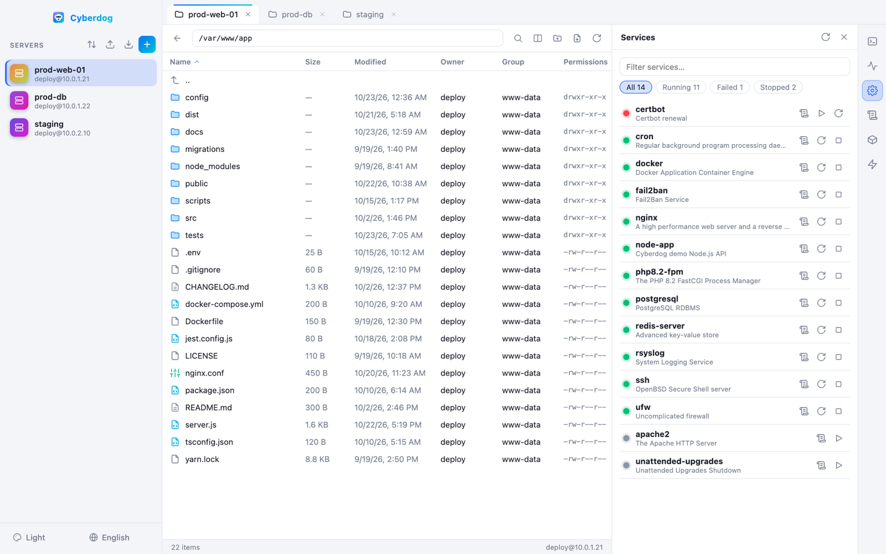

### Logs en direct

Le bouton 📜 suit vos logs en temps réel : le **journal système** (`journalctl -f`), **une unité**, les logs **Nginx** (erreurs/accès), `syslog`, `auth.log` ou **n'importe quel fichier**. Filtrez par texte et par niveau, repérez les erreurs et avertissements **en surbrillance** (avec compteurs), mettez en pause en remontant, et gardez vos **recherches favorites** à un clic.

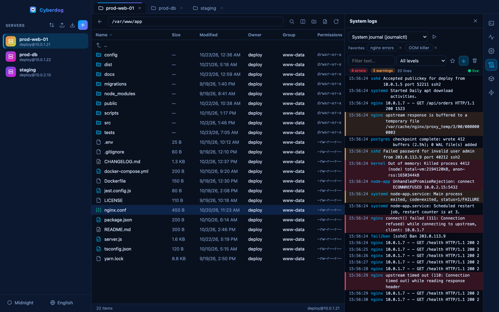

### Docker

Le bouton 📦 liste vos conteneurs avec leur **utilisation CPU / RAM en direct**, permet de les **démarrer, arrêter et redémarrer**, de **suivre leurs logs en direct** et d'**inspecter** conteneurs et images (ports, volumes, variables, couches…). Idéal si vos serveurs hébergent des applications conteneurisées.

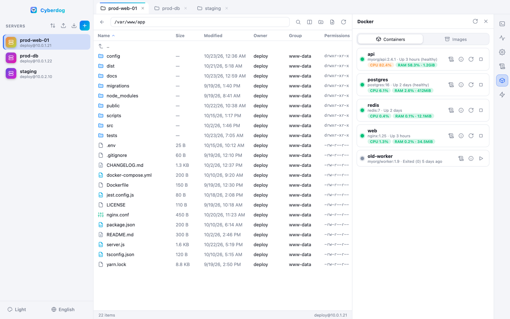
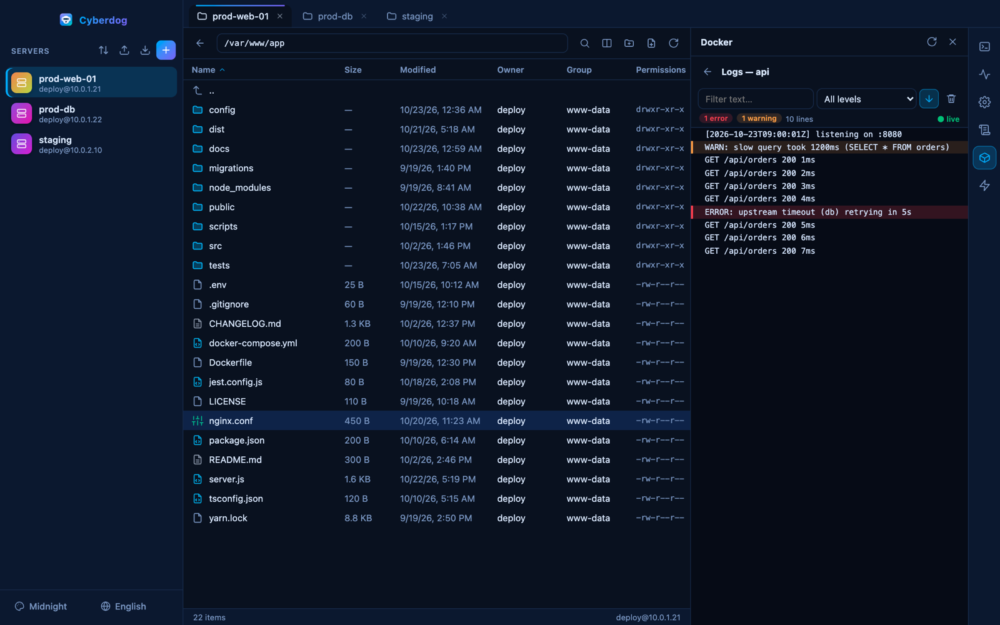

### Actions rapides

Enregistrez vos scripts bash du quotidien (redémarrer une stack, nettoyer les logs, rapport disque…) à côté de vos serveurs. Lancez-en un sur le serveur courant, ou sur **tous les serveurs ouverts en même temps**, et lisez chaque sortie dans le panneau. Exportez vos actions dans un zip pour les partager avec votre équipe.

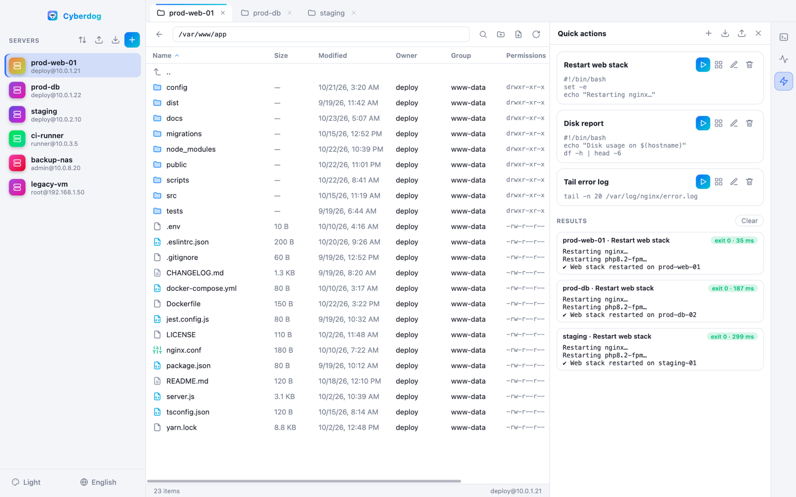

### Thèmes et langues

Système, Clair, Sombre, Minuit, Dracula, Forêt et Coucher de soleil — le terminal suit. L'interface existe en **English, Français, Deutsch et Italiano**.

<table>
  <tr>
    <td>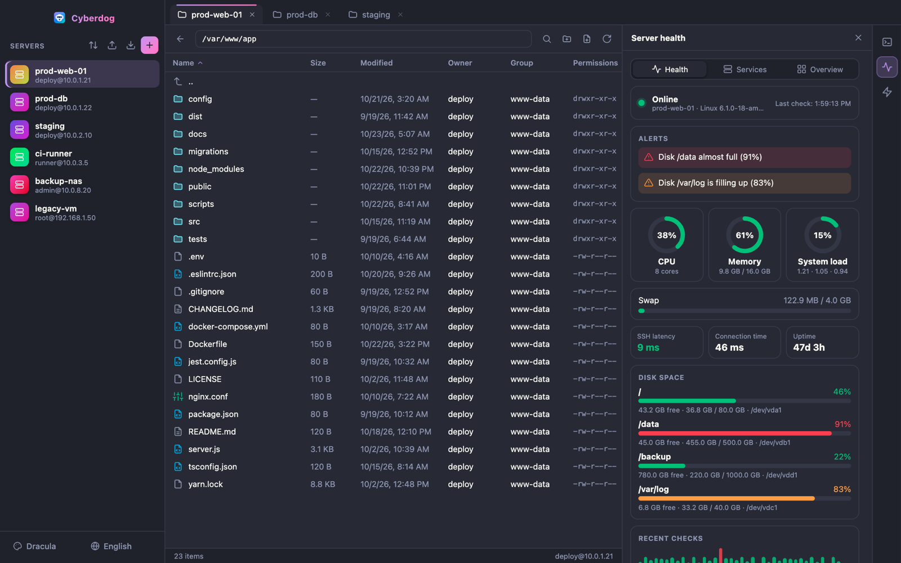</td>
    <td>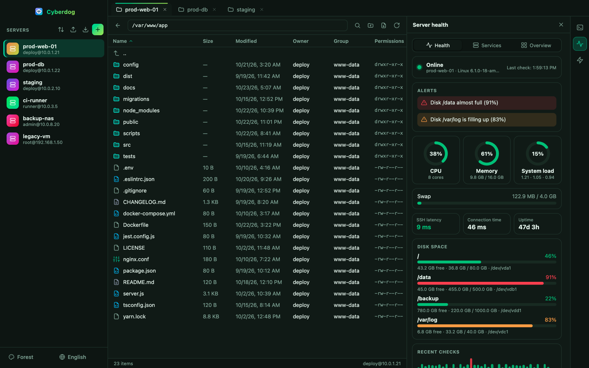</td>
    <td>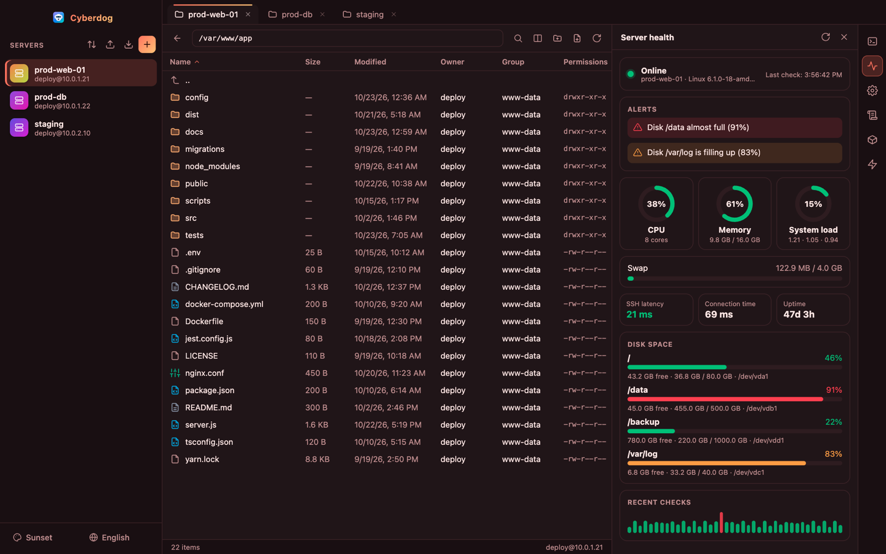</td>
  </tr>
</table>

---

## 🔒 Sécurité et vie privée

- Les mots de passe sont **chiffrés par le trousseau de votre système** (Trousseau macOS / DPAPI Windows) et ne quittent jamais votre machine. Les exports ne contiennent ni mots de passe ni empreintes d'hôte.
- Les **clés d'hôte** sont mémorisées à la première connexion (trust on first use) ; une clé modifiée bloque la connexion tant que vous ne l'acceptez pas.
- Les mots de passe `sudo` transitent par le canal SSH chiffré, sur stdin, jamais en ligne de commande.
- Aucune télémétrie, aucun compte, aucun cloud : votre configuration, ce sont des fichiers JSON sur votre disque.

La configuration se trouve dans :

| | |
|---|---|
| macOS | `~/Library/Application Support/Cyberdog/` |
| Windows | `%APPDATA%\Cyberdog\` |

(`servers/` et `actions/` contiennent un fichier JSON par élément, `settings.json` la langue et le thème.)

---

## 🛠️ Compiler depuis les sources

Prérequis : [Node.js](https://nodejs.org) 22+.

```sh
git clone https://github.com/pickywawa/cyberdog.git
cd cyberdog
npm install

npm start          # lancer l'app
npm test           # tests unitaires
npm run dist:mac   # .dmg macOS (arm64 + x64)       — à lancer sur un Mac
npm run dist:win   # installeur + portable Windows  — à lancer sur Windows
```

Les installeurs sont produits dans `dist/`. Les icônes se régénèrent depuis `src/assets/icon.svg` avec `npm run icons` (macOS).

### Releases (CI/CD)

| Workflow | Déclencheur | Rôle |
|---|---|---|
| [`ci.yml`](.github/workflows/ci.yml) | chaque push / pull request | lance les tests sous Linux et macOS |
| [`release.yml`](.github/workflows/release.yml) | tag `v*` (ou lancement manuel) | compile les artefacts Community macOS et Windows ; les versions officielles sont publiées depuis le dépôt privé |

Pour publier une nouvelle version :

```sh
npm version patch        # ou minor / major : met à jour package.json et crée le tag v*
git push --follow-tags   # compile uniquement les artefacts Community
```

La publication officielle s’effectue ensuite dans le workflow du dépôt privé, avec ce tag, la configuration Live et le secret `CYBERDOG_RELEASE_TOKEN`.


---

## 🧱 Technique

Electron · [ssh2](https://github.com/mscdex/ssh2) (SFTP, shell, exec) · [xterm.js](https://xtermjs.org) · HTML/CSS/JS pur (ni framework, ni bundler).

```
src/main.js        process principal : SSH/SFTP, stockage, IPC
src/renderer.js    explorateur, onglets, terminal, recherche
src/panels.js      tableau de bord santé, actions rapides
src/ops.js         services, logs en direct, Docker
src/archive.js     détection des archives + commandes de désarchivage
src/health.js      script de santé distant + parseurs
src/i18n.js        traductions (EN/FR/DE/IT)
```

## 📄 Licence

[MIT](LICENSE) © pickywawa

### Gestionnaire de transferts et navigation distante

Le pied de l’explorateur affiche l’envoi ou le téléchargement en cours. Survolez-le ou cliquez dessus pour voir les transferts simultanés, leur progression, le débit, le temps restant estimé, les boutons d’annulation et les résultats récents. Les dossiers incluent leurs fichiers imbriqués. Une annulation peut laisser un fichier partiel à destination ; les fichiers déjà transférés sont conservés. L’historique récent reste en mémoire et peut être effacé.

Le champ de chemin reconnaît `~` et `~/…` comme le dossier personnel de l’utilisateur connecté. Saisir le chemin d’un fichier ouvre son dossier parent et sélectionne le fichier. Les chemins enregistrés sont disponibles dès le démarrage, y compris dans le menu du champ de chemin.

Le gestionnaire de clés SSH liste aussi les clés publiques autorisées sur le serveur courant dans `~/.ssh/authorized_keys`, avec leurs empreintes SHA-256. Elles sont séparées des clés gérées localement. La lecture dépend des permissions du fichier distant ; aucune clé privée n’est lue sur le serveur.

## Site web

Le site vitrine bilingue est hébergé sur [pickywawa.github.io/cyberdog](https://pickywawa.github.io/cyberdog/). Ses fichiers statiques sont dans [site/](site/), déployés par GitHub Actions lorsqu’ils changent sur main. Prévisualisation locale : `python3 -m http.server 8765 --directory site`.

### Éléments partagés et historique Premium

Les formulaires des groupes, actions rapides et chemins enregistrés proposent **Local**, **Mon espace** et les **équipes** disposant du droit de modification. Les groupes restent propres à leur espace ; les chemins et actions personnels sont disponibles sur vos serveurs, ceux d’une équipe sur les serveurs de cette équipe. Un script partagé est affiché intégralement avant exécution et vérifié à nouveau côté serveur avant lancement. Évitez de placer des secrets dans ces scripts partagés.

Les droits lecture seule/modification des membres couvrent les serveurs et ces éléments partagés. Le catalogue est chargé au démarrage et après vos modifications ; les changements des autres membres apparaissent au prochain lancement.

Le menu contextuel d’un serveur partagé propose **Historique des serveurs**. Le panneau Premium donne également accès à l’historique de Mon espace et de chaque équipe, y compris aux serveurs supprimés. Chaque version indique la date, l’adresse email et l’identifiant de licence de l’auteur. Une restauration crée une nouvelle version et nécessite le droit de modification. Seuls le nom, l’hôte, le port, l’utilisateur SSH et le groupe sont historisés : aucun mot de passe ou clé SSH. Les anciennes configurations locales ne sont pas historisées. Une licence partagée identifie la licence, pas la personne qui l’utilise.

### Coffres de secrets Premium

L’onglet **Paramètres → Coffres de secrets** (étoile Premium) permet d’intégrer **1Password**, **Bitwarden/Vaultwarden**, **HashiCorp Vault KV v2**, **AWS Secrets Manager**, **Azure Key Vault**, **TeamPass 3.2**, **Keeper Secrets Manager/PAM**, **ManageEngine Password Manager Pro Enterprise**, **Devolutions Server** et **Remote Desktop Manager sous Windows** directement à la liste des serveurs. Les raccourcis et paramètres restent locaux, exclus des exports et de Supabase. Les mots de passe et clés SSH sont lus à la connexion ; un verrouillage ferme les connexions du coffre.

Voir le [guide de configuration et les fournisseurs étudiés](./docs/secret-vaults.md) pour les prérequis CLI, sessions, droits Vault et champs personnalisés.

Les paramètres utilisent désormais une navigation latérale. Les implémentations Premium sont conservées dans le dépôt privé ; une copie publique fonctionne sans elles.
