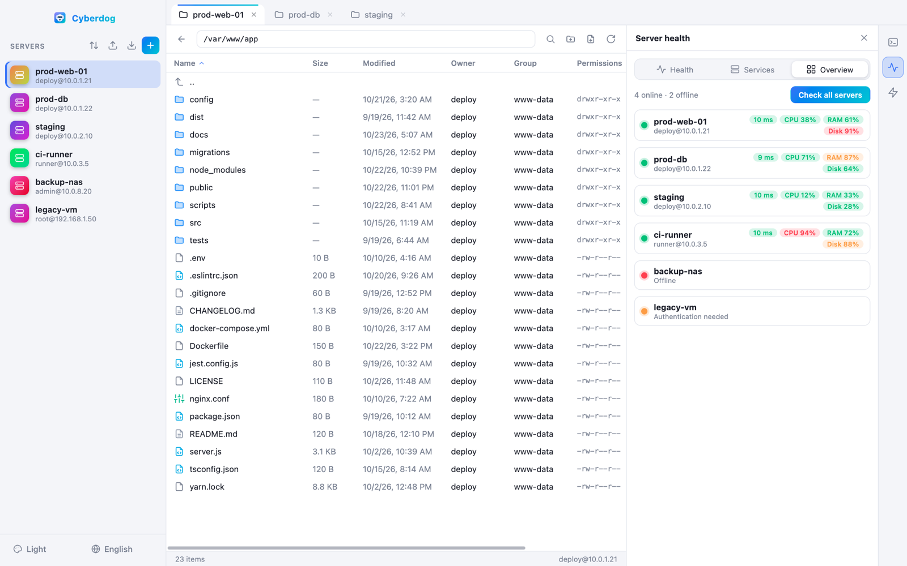

<div align="center">


# Cyberdog

**Tous vos serveurs SSH dans une seule belle fenêtre.**<br>
Une alternative moderne et rapide à Cyberduck : explorateur SFTP, terminal intégré, tableau de bord de santé des serveurs et scripts en un clic — pour macOS et Windows.


[English](README.md) · **Français**


</div>

---

## ✨ Pourquoi Cyberdog ?

| | |
|---|---|
| 📁 **Un vrai explorateur de fichiers** | Naviguez sur un serveur comme dans un dossier local : colonnes triables (nom, taille, date, propriétaire, groupe, permissions, type, extension), glisser-déposer depuis le bureau, actions au clic droit, **recherche distante instantanée**. |
| 🖥️ **Terminal inclus** | Un clic ouvre un terminal SSH *sous* l'explorateur, déjà placé dans le dossier que vous parcourez. Fini la jonglerie entre fenêtres. |
| 📈 **La santé du serveur d'un coup d'œil** | En ligne/hors ligne, CPU, RAM, charge, disques avec alertes, uptime, latence SSH — et les services `systemctl` à démarrer, arrêter, redémarrer. |
| ⚡ **Actions rapides** | Enregistrez vos scripts bash une fois, lancez-les sur un serveur — ou sur **tous les serveurs ouverts** — en un clic. |
| 🔁 **Partagez votre configuration** | Un fichier JSON par serveur. Exportez/importez un zip (jamais de mot de passe dedans) ou importez vos favoris **Cyberduck**. |
| 🎨 **Pensé pour être beau** | 7 thèmes, 4 langues, barres de défilement discrètes, autant d'onglets de serveurs que vous voulez. |

---

## 📦 Installation

Téléchargez le dernier installeur depuis la **[page des Releases](https://github.com/pickywawa/cyberdog/releases/latest)**.

### macOS (Apple Silicon et Intel)

1. Téléchargez `Cyberdog-<version>-mac-arm64.dmg` (Apple Silicon : M1/M2/M3/M4) ou `Cyberdog-<version>-mac-x64.dmg` (Intel).
2. Ouvrez le `.dmg` et glissez **Cyberdog** dans **Applications**.
3. Premier lancement : l'app n'est pas encore notarisée, macOS peut donc la bloquer. Faites **clic droit → Ouvrir → Ouvrir**, ou exécutez une fois :
   ```sh
   xattr -dr com.apple.quarantine /Applications/Cyberdog.app
   ```

### Windows (10 / 11, 64 bits)

- **Installeur** : `Cyberdog-Setup-<version>-x64.exe` — choix du dossier d'installation, raccourcis menu Démarrer et bureau.
- **Portable** : `Cyberdog-<version>-portable-x64.exe` — sans installation, à lancer depuis n'importe où (clé USB, dossier partagé…).

> Au premier lancement, Windows SmartScreen peut signaler un éditeur inconnu (l'app n'est pas encore signée) : cliquez sur **Informations complémentaires → Exécuter quand même**.

Chaque release contient aussi un fichier `SHA256SUMS.txt` pour vérifier votre téléchargement.

---

## 🚀 Visite guidée

### Vos serveurs à un clic

Ajoutez un serveur avec un nom, un hôte, un login et un mot de passe (ou utilisez votre agent / clé SSH). Réorganisez-les par glisser-déposer, triez de A à Z et **importez tout depuis Cyberduck** en un clic. La page d'accueil vous guide parmi les options.


### Un explorateur de fichiers moderne

Dossiers d'abord, icônes colorées selon le type de fichier, sélection multiple (⌘/Ctrl-clic, Maj-clic) et un menu clic droit : *Télécharger sous…, Copier le nom, Copier le chemin complet, Éditer avec…, Renommer, Supprimer, Nouveau dossier, Nouveau fichier*.


**Éditer avec…** télécharge le fichier, l'ouvre dans VS Code, Cursor, Sublime Text, Notepad++, TextEdit… (ce qui est installé) et **le renvoie sur le serveur à chaque enregistrement**.


**Recherchez sur le serveur** (🔍 ou ⌘/Ctrl-F) : tapez quelques lettres, obtenez des suggestions en direct — dans le dossier courant ou sur tout le serveur — et allez directement dans le dossier parent du fichier, déjà sélectionné.


**Glisser-déposer** : déposez des fichiers du bureau pour les envoyer (dossiers compris), ou glissez des fichiers de Cyberdog vers votre bureau pour les télécharger.

### Le terminal, là où vous travaillez

Le terminal s'ouvre sous l'explorateur, démarre dans le dossier courant et reste ouvert quand vous changez de panneau. Un splitter permet de le redimensionner.

### Tableau de bord de santé

Cliquez sur le bouton 📈 de la barre d'outils de droite. Toutes les 10 secondes :

- Statut **en ligne / hors ligne** et heure de la dernière vérification
- **CPU, mémoire, swap et charge système**
- **Espace disque par volume** avec avertissement à 80 % et alerte critique à 90 %
- **Uptime, latence SSH et temps de connexion**, avec l'historique des dernières vérifications


L'onglet **Services** liste vos services `systemctl` avec leur état, une recherche et des filtres. Démarrez un service arrêté, redémarrez ou arrêtez un service actif — `sudo` est géré pour vous si vous n'êtes pas root.


L'onglet **Vue globale** vérifie *tous* vos serveurs enregistrés d'un coup, pour voir en un regard lesquels sont sains, surchargés ou hors ligne.



### Actions rapides

Enregistrez vos scripts bash du quotidien (redémarrer une stack, nettoyer les logs, rapport disque…) à côté de vos serveurs. Lancez-en un sur le serveur courant, ou sur **tous les serveurs ouverts en même temps**, et lisez chaque sortie dans le panneau. Exportez vos actions dans un zip pour les partager avec votre équipe.


### Thèmes et langues

Système, Clair, Sombre, Minuit, Dracula, Forêt et Coucher de soleil — le terminal suit. L'interface existe en **English, Français, Deutsch et Italiano**.

<table>
  <tr>
    <td></td>
    <td></td>
    <td></td>
  </tr>
</table>

---

## 🔒 Sécurité et vie privée

- Les mots de passe sont **chiffrés par le trousseau de votre système** (Trousseau macOS / DPAPI Windows) et ne quittent jamais votre machine. Les exports ne contiennent ni mots de passe ni empreintes d'hôte.
- Les **clés d'hôte** sont mémorisées à la première connexion (trust on first use) ; une clé modifiée bloque la connexion tant que vous ne l'acceptez pas.
- Les mots de passe `sudo` transitent par le canal SSH chiffré, sur stdin, jamais en ligne de commande.
- Aucune télémétrie, aucun compte, aucun cloud : votre configuration, ce sont des fichiers JSON sur votre disque.

La configuration se trouve dans :

| | |
|---|---|
| macOS | `~/Library/Application Support/Cyberdog/` |
| Windows | `%APPDATA%\Cyberdog\` |

(`servers/` et `actions/` contiennent un fichier JSON par élément, `settings.json` la langue et le thème.)

---

## 🛠️ Compiler depuis les sources

Prérequis : [Node.js](https://nodejs.org) 22+.

```sh
git clone https://github.com/pickywawa/cyberdog.git
cd cyberdog
npm install

npm start          # lancer l'app
npm test           # tests unitaires
npm run dist:mac   # .dmg macOS (arm64 + x64)       — à lancer sur un Mac
npm run dist:win   # installeur + portable Windows  — à lancer sur Windows
```

Les installeurs sont produits dans `dist/`. Les icônes se régénèrent depuis `src/assets/icon.svg` avec `npm run icons` (macOS).

### Releases (CI/CD)

| Workflow | Déclencheur | Rôle |
|---|---|---|
| [`ci.yml`](.github/workflows/ci.yml) | chaque push / pull request | lance les tests sous Linux et macOS |
| [`release.yml`](.github/workflows/release.yml) | tag `v*` (ou lancement manuel) | compile le `.dmg` macOS et les `.exe` Windows, puis publie une Release GitHub avec les checksums |
| [`.gitlab-ci.yml`](.gitlab-ci.yml) | push, tag `v*` | même pipeline pour GitLab : tests, build Windows (Linux + wine), build macOS optionnel sur un runner `macos`, Release via le Package Registry |

Pas de runner macOS sur votre GitLab ? Construisez le `.dmg` sur votre Mac et rattachez-le à la release :

```sh
export GITLAB_TOKEN=<jeton personnel, scope api> CI_API_V4_URL=<gitlab>/api/v4 CI_PROJECT_ID=<id> CI_COMMIT_TAG=v1.2.3
npm run dist:mac && sh ci/upload.sh dist/*.dmg && node ci/publish-release.mjs
```

Pour publier une nouvelle version :

```sh
npm version patch        # ou minor / major : met à jour package.json et crée le tag v*
git push --follow-tags   # la pipeline compile et publie la release
```

---

## 🧱 Technique

Electron · [ssh2](https://github.com/mscdex/ssh2) (SFTP, shell, exec) · [xterm.js](https://xtermjs.org) · HTML/CSS/JS pur (ni framework, ni bundler).

```
src/main.js        process principal : SSH/SFTP, stockage, IPC
src/renderer.js    explorateur, onglets, terminal, recherche
src/panels.js      tableau de bord santé, services, actions rapides
src/health.js      script de santé distant + parseurs
src/i18n.js        traductions (EN/FR/DE/IT)
```

## 📄 Licence

[MIT](LICENSE) © pickywawa
