<div align="center">

### 🌐 **[pickywawa.github.io/cyberdog](https://pickywawa.github.io/cyberdog/)**
**Website · screenshots · comparisons · downloads**


# Cyberdog

**Your SSH servers, one beautiful window.**<br>
A free, open-source alternative to Cyberduck, WinSCP and Termius: SFTP explorer, built-in terminal, server-health dashboard and one-click scripts. Also speaks FTP, S3, Azure, WebDAV and cloud drives. For macOS, Windows and Linux.

[**🌐 Website**](https://pickywawa.github.io/cyberdog/) · [**⬇️ Download**](https://github.com/pickywawa/cyberdog/releases/latest) · [**Cyberduck alternative**](https://pickywawa.github.io/cyberdog/cyberduck-alternative.html) · [**WinSCP alternative**](https://pickywawa.github.io/cyberdog/winscp-alternative.html) · [**Termius alternative**](https://pickywawa.github.io/cyberdog/termius-alternative.html)


**English** · [Français](README.fr.md)

<a href="https://pickywawa.github.io/cyberdog/"></a>

</div>

---

## ✨ Why Cyberdog?

| | |
|---|---|
| 📁 **A real file explorer** | Browse any server like a local folder: sortable columns, clickable path, drag & drop, **copy / cut / paste between servers**, a transfer queue that asks what to do with existing files, **instant remote search**, name filter, **split view**, properties and one-click **archive extraction**. |
| ✍️ **Built-in editor** | Double-click a file to edit it in the editor of VS Code, with syntax colours, tabs and split view. Encodings and line endings are kept as they are. |
| 🖥️ **Terminal included** | One click opens an SSH terminal *under* the explorer, already `cd`'d into the folder you are browsing. No more juggling windows. |
| 📈 **Server health at a glance** | Online/offline, CPU, RAM, load, disks with alerts, uptime and SSH latency. |
| ⚙️ **Services, logs & Docker** | Start/stop/restart `systemctl` services, follow `journalctl` / Nginx / app logs live (level filters, error highlighting, favorite searches), manage Docker containers (live logs, CPU/RAM, start/stop) and inspect images. |
| ⚡ **Quick actions** | Save bash scripts once, run them on one server — or on **all open servers** — with one click. Actions can ask questions (lists, text, buttons), download files and drive Cyberdog. |
| 🔌 **Many protocols** | SFTP, FTP/FTPS, S3 and compatibles (AWS, Google Cloud Storage, Backblaze B2, Wasabi…), Azure Blob and Files, WebDAV, SMB, Dropbox, OneDrive and Google Drive, all in the same explorer. |
| 🛡️ **Bastions** | Reach private servers through a reusable bastion, with a route test and fingerprint checks. |
| 👥 **Free teams** | Share servers, scripts and paths with roles, invitation links and history. The account is optional. |
| 🔐 **Secret vaults** | 1Password, Bitwarden, HashiCorp Vault, AWS Secrets Manager, Azure Key Vault and five more: credentials are read at connection time. |
| 🔁 **Share your setup** | Selectively export groups, servers, actions and paths to ZIP. Import configuration, **Cyberduck**, **FileZilla XML** and **WinSCP INI**. |
| 🎨 **Made to look good** | 7 themes, 14 languages, discreet scrollbars, tabs for as many servers as you like. |

---

## 🔌 Supported protocols

Every protocol opens in the same explorer, with the same tabs, split view, search, drag & drop and transfer manager. Terminal, health, services, logs and Docker are for SSH servers.

| Protocol | What you get |
|---|---|
| **SFTP / SSH** | Explorer, terminal, health dashboard, services, logs, Docker, processes, SSL certificates and SSH keys. Password, key or SSH agent, and jump hosts through a bastion (see below). |
| **FTP / FTPS** | Explicit or implicit TLS, option to accept self-signed certificates, streamed uploads, Unix permissions (`SITE CHMOD`), up to three parallel control connections. |
| **S3 and compatible** | AWS (profiles from `~/.aws`, IAM Identity Center, role assumption), Google Cloud Storage, Backblaze B2, Wasabi, DigitalOcean Spaces, Scaleway or any custom endpoint. Session tokens, multipart uploads above 64 MB, virtual-hosted addressing and **shared links** (presigned URLs, up to 7 days). |
| **Azure Blob Storage** | Account key, SAS token or Microsoft Entra ID (service principal, device code, Azure CLI), plus read-only SAS **shared links**. |
| **Azure Files** | File shares of an Azure storage account. |
| **WebDAV** | Basic, Digest and Bearer-token authentication, automatic scheme detection, option to accept untrusted certificates. |
| **SMB / Windows shares** | Through the system's own SMB client (`mount_smbfs` on macOS, UNC paths on Windows). |
| **Dropbox, OneDrive, Google Drive** | OAuth sign-in in your browser. Enter the client ID of your own application, or use the one bundled by the maintainers. |

FTP, S3, Azure, WebDAV and the cloud drives can go through an **HTTP (CONNECT) or SOCKS5 proxy**, with optional credentials. Interrupted transfers can be **resumed**, files can be copied **from one server to another** without staging them on disk, and an optional **local pane** opens this computer's files beside the server.

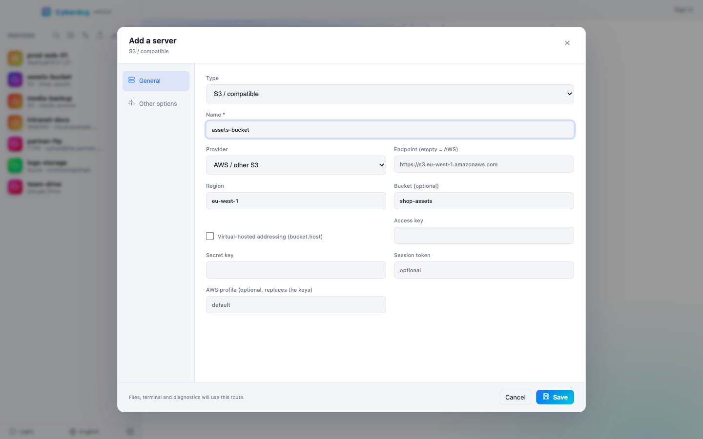
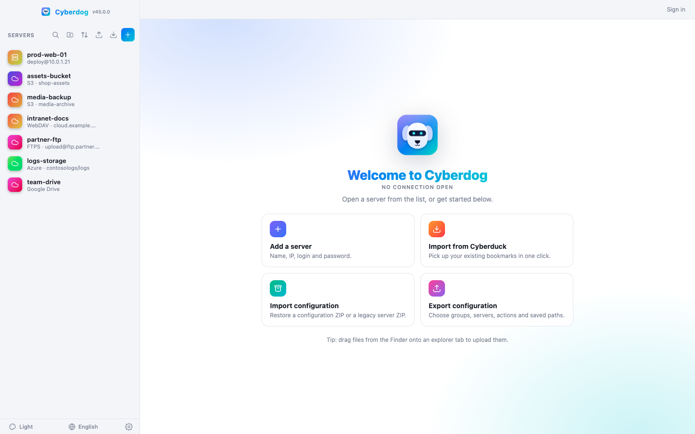

## 🔁 Coming from Cyberduck, WinSCP, FileZilla or Termius?

- **Import your servers:** the import menu reads **Cyberduck** bookmarks, **FileZilla** (`sitemanager.xml` or an XML export), **WinSCP** (INI from *Tools → Export/Backup configuration*) and Cyberdog ZIP files. Third-party passwords are not imported.
- **Comparisons, including where the others are better:** [Cyberdog vs Cyberduck](https://pickywawa.github.io/cyberdog/cyberduck-alternative.html) · [Cyberdog vs WinSCP](https://pickywawa.github.io/cyberdog/winscp-alternative.html) · [Cyberdog vs Termius](https://pickywawa.github.io/cyberdog/termius-alternative.html).

---

## 🛡️ Bastions (jump hosts)

Reach servers that are only visible from a bastion, without opening a terminal on the bastion first. In a server's form, choose **Network access → Via a bastion** and pick the bastion among your servers.

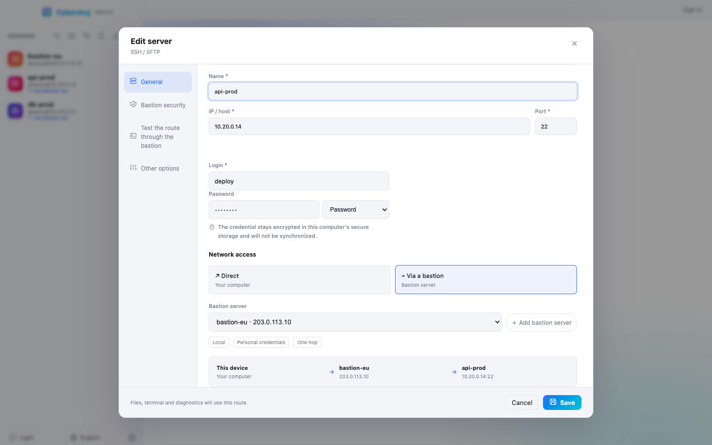

- **How it works:** Cyberdog connects to the bastion over SSH, opens a channel to the target's SSH port, then starts a **second SSH session from your computer** through that channel. The final session stays end-to-end encrypted: the bastion sees where you connect, not what you do, and never receives the target's private key. Nothing to install on the bastion, whose SSH server must allow TCP forwarding.
- **Reusable:** a bastion is an ordinary server entry, with its own credentials, used by as many servers as you like. One hop per server: a bastion cannot itself go through another bastion. The bastion and the target must live in the same space (local, personal or the same team).
- **Test the route before saving:** configuration, SSH connection to the bastion, channel to the target, target authentication and an SFTP check. The test saves nothing and closes its temporary connections.
- **Fingerprints:** the bastion and target host keys are shown for verification the first time, a changed fingerprint blocks the connection, and trust can be reset from the server's form.
- **Interactive authentication:** passphrases and keyboard-interactive or MFA prompts appear when connecting.
- **Same route everywhere:** files, terminal, health dashboard, services, logs and Docker all use it.

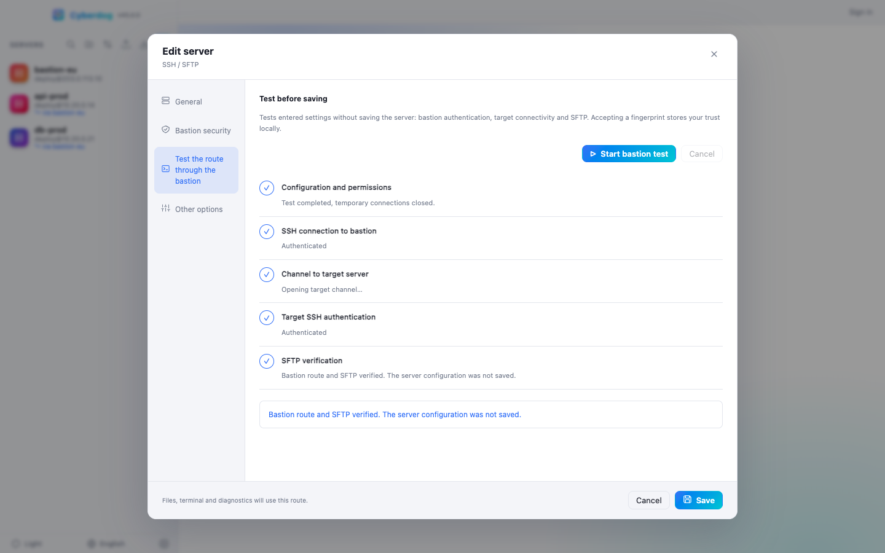

---

## 👥 Teams, sharing and secret vaults

Cyberdog works without an account. A free, optional account adds teams:

- **Sign in** from *Settings → Sign in* with your e-mail address; a code sent by e-mail verifies it. You can delete your account from the same page.
- **Personal space and teams**, with roles (owner, administrator, member) and read-only or edit rights per member on the shared configuration.
- **Invitation links**, valid 7 days, for one or several uses, revocable.
- **Shared servers, groups, quick actions and saved paths**, in *Local*, *My workspace* or a team you can edit.
- **Server history:** who changed what and when, and restore a previous version.
- SSH passwords and keys stay on your computer unless you choose to sync them for a shared server, in which case they are encrypted server-side.

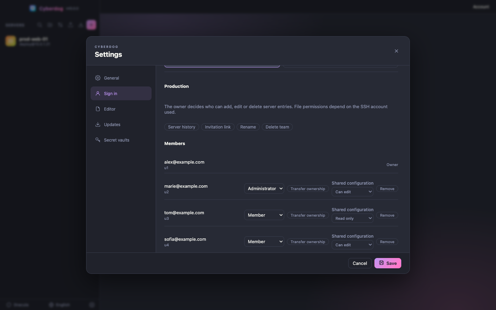

### Shared assets and server history

Groups, quick actions and saved paths support **Local**, **My workspace** and writable **team** locations. Groups stay within their workspace; personal paths/actions can be used on your servers, while team paths/actions apply to that team's servers. Shared scripts require full preview and are revalidated before execution. Do not embed credentials in shared scripts.

Member read/write permissions cover shared configuration and server restoration. Catalogs load at startup and after your own changes; other members' changes are available on the next launch.

Open server history from a shared server's context menu or the personal/team panel in Settings → Sign in, including deleted servers. Revisions record the signed-in account, email, time and configuration. Restoring creates another revision and requires write permission. Snapshots include only name, host, port, SSH username and group, never SSH credentials. Local configurations have no cloud history. Attribution identifies the account that made the change.

### Secret vault integrations

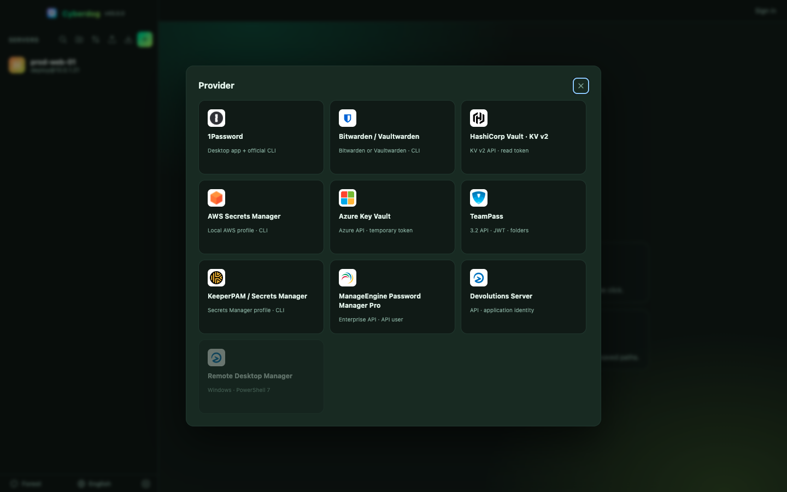

**Settings → Secret vaults** adds **1Password**, **Bitwarden/Vaultwarden**, **HashiCorp Vault KV v2**, **AWS Secrets Manager**, **Azure Key Vault**, **TeamPass 3.2**, **Keeper Secrets Manager/PAM**, **ManageEngine Password Manager Pro Enterprise**, **Devolutions Server** and **Windows Remote Desktop Manager** entries to dedicated sections in the server list. Connectors and shortcuts stay local, excluded from exports and Supabase. Passwords and SSH keys are read on connection; locking a vault closes its connections.

See the [setup guide and provider comparison](./docs/secret-vaults.md) for CLI prerequisites, sessions, Vault policies and custom field mapping.

---

## ⚙️ Settings

The **Settings** button beside the language selector — or **Cyberdog → Settings…** on macOS — groups language, theme, default editor and update preferences. You can also select an external configuration folder to share servers, groups, quick actions, saved paths and favorite searches while keeping personal preferences local to each computer.

Window size, position and maximized state are restored at the next launch. If a monitor is disconnected, the window returns to an available screen.

An optional **Reopen connections at startup** checkbox restores the server tabs and terminals left open when quitting. It is disabled by default. It stores only server references and whether a terminal was open; terminal commands are never replayed.

Double-clicking a file opens it in the selected editor and uploads every saved change back to the server.

---

## 📦 Install

Download the latest installer from the **[Releases page](https://github.com/pickywawa/cyberdog/releases/latest)**.

Cyberdog shows its version beside the logo and highlights new versions with an animated **New** badge. On Windows (standard installation), click it to download and install the update, then restart the app. On macOS, once the DMG has downloaded, Cyberdog offers to open it and quit automatically so you can drag the update into Applications, then reopen the app. Choose Later to keep using Cyberdog and install the downloaded DMG another time. If the DMG cannot be opened, Cyberdog stays running. The portable Windows build downloads and opens its executable.

Update checks and downloads use Electron’s native networking to honor the system proxy, including enterprise PAC/WPAD configurations.

### macOS (Apple Silicon & Intel)

With [Homebrew](https://github.com/pickywawa/homebrew-cyberdog): `brew install --cask pickywawa/cyberdog/cyberdog`

Or by hand:

1. Download `Cyberdog-<version>-mac-arm64.dmg` (Apple Silicon: M1/M2/M3/M4) or `Cyberdog-<version>-mac-x64.dmg` (Intel).
2. Open the `.dmg` and drag **Cyberdog** to **Applications**.
3. Since 1.10.1 the app is signed with an Apple Developer ID certificate and **notarized**: it opens like any other Mac app. Versions before 1.10.1 are not notarized, so macOS may block them: **right-click → Open → Open**, or run once:
   ```sh
   xattr -dr com.apple.quarantine /Applications/Cyberdog.app
   ```

### Windows (10 / 11, 64-bit)

- **Installer**: `Cyberdog-Setup-<version>-x64.exe` — choose the install folder, get Start-menu and desktop shortcuts.
- **Portable**: `Cyberdog-<version>-portable-x64.exe` — no installation, run it from anywhere (USB stick, shared folder…).

> On first launch Windows SmartScreen may warn about an unrecognized publisher (the app is not code-signed yet): click **More info → Run anyway**.

Each release also ships a `SHA256SUMS.txt` so you can verify your download.

### Linux (x64)

- **AppImage:** `Cyberdog-<version>-linux-x86_64.AppImage`. Make it executable (`chmod +x`) and run it.
- **Debian / Ubuntu:** `Cyberdog-<version>-linux-amd64.deb`, installed with `sudo apt install ./Cyberdog-<version>-linux-amd64.deb`.

---

## 🚀 Tour

### Export and import configuration

**Export configuration** opens a category selector: groups (when present), servers, quick actions and saved paths. All categories start checked and collapsed. Expand them to select individual items, or use each category checkbox to select or clear all of its items.

The ZIP contains a `manifest.json` and `groups/`, `servers/`, `actions/` and `paths/` folders, with one JSON file per selected item. Server passwords, host fingerprints and private key files are excluded. Action scripts are exported as written.

**Import → Configuration ZIP** restores these categories together and also accepts legacy server or action ZIPs. Imports merge without overwriting existing connection credentials. Saved paths are mapped to matching servers even when their internal IDs differ. A server-specific path exported without its server requires that server to already exist at the destination; unmatched paths are skipped and counted in the result.

The import menu retains **Cyberduck** and adds SFTP sites from **FileZilla** (`sitemanager.xml` or an XML export) and **WinSCP** (INI via [Tools → Export/Backup configuration](https://winscp.net/eng/docs/config)). Third-party passwords are not imported. Transmit and SolarWinds formats are not supported yet.

Saved paths live in the version-independent user data directory. Writes are atomic, with a `paths.json.bak` copy for recovery if the primary file becomes unreadable. An unavailable external configuration directory retains its saved location and shows a message instead of silently switching directories.

### Open your servers with a click

Click a server (or press Enter on a focused server) to open it. An animated Cyberdog and opening status appear in the central workspace while connecting.

Add servers with a name, host, login and password (or rely on your SSH agent / key). Drag them to reorder, sort A→Z, and **import everything from Cyberduck** in one click. The welcome page walks you through the options.

Keep a long list tidy: **groups** (collapsible, remembered between launches), **favorites** (★ on a server or a whole group: they float to the top under a *Favorites* separator), a **live search** box (🔍) that filters servers and groups as you type, and **Duplicate** in the right-click menu to create a new server pre-filled from an existing one. Drag a server onto a group to move it.

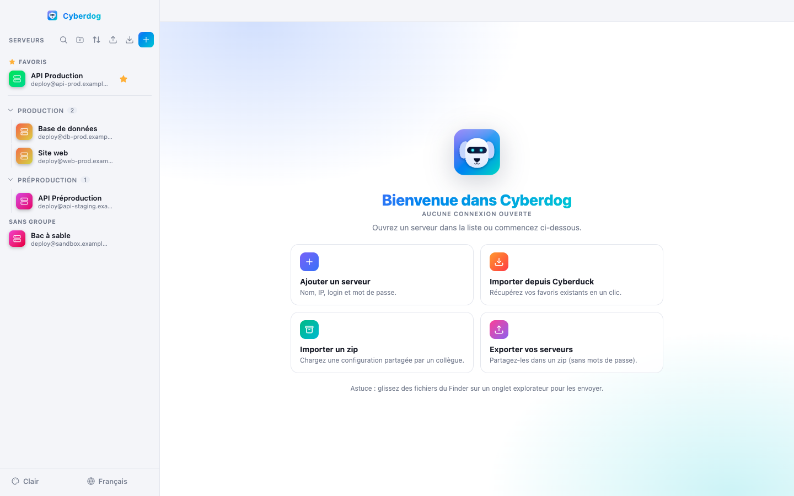

Right-click a server and choose **Duplicate** to open a prefilled form without creating a connection or copying its identity.

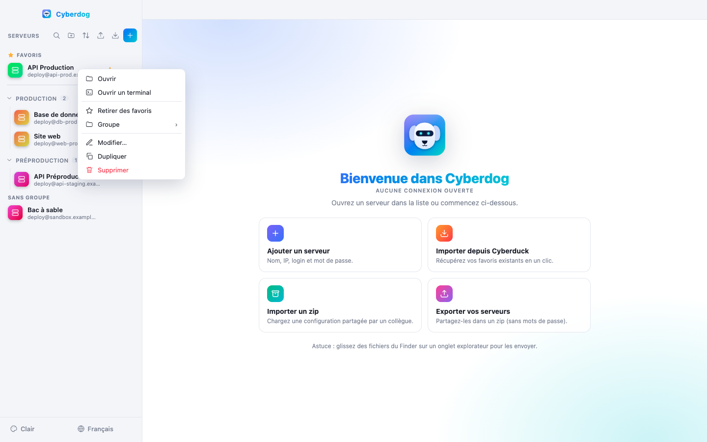

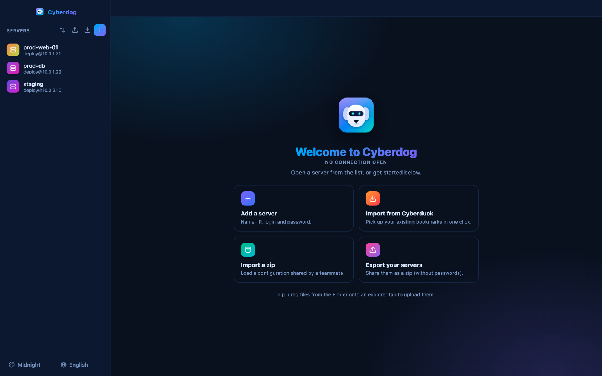

### A modern file explorer

Folders first, colored icons by file type, multi-selection (⌘/Ctrl-click, Shift-click), and a right-click menu with *Download as…, Copy name, Copy full path, Edit with…, Extract, Rename, Delete, New folder, New file*.

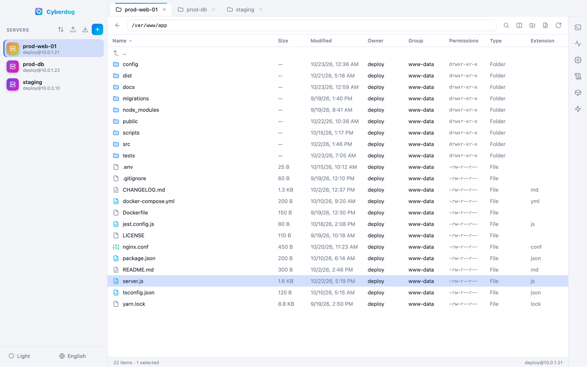

**Edit with…** downloads the file, opens it in VS Code, Cursor, Sublime Text, Notepad++, TextEdit… (whatever is installed) and **uploads it back every time you save**.

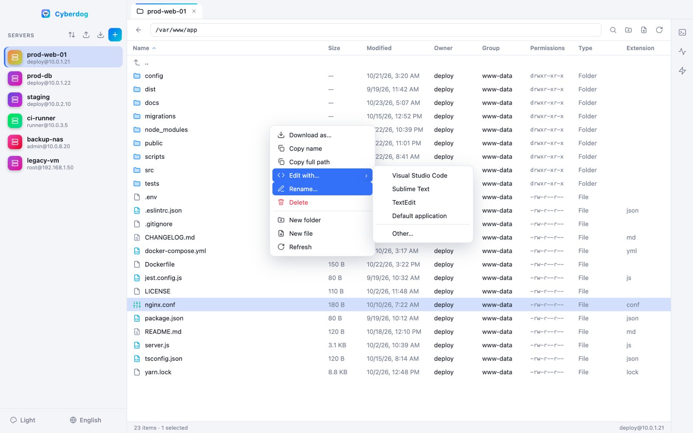

**Saved paths**: the 🔖 button inside the path bar drops down your favorite folders (per server or for all servers) — click one to jump there. Manage them from the 🔖 button of the right-hand toolbar.

**Search the server** (🔍 or ⌘/Ctrl-F): type a few letters, get live suggestions — in the current folder or on the whole server — and jump straight to the file's parent folder with the file selected.

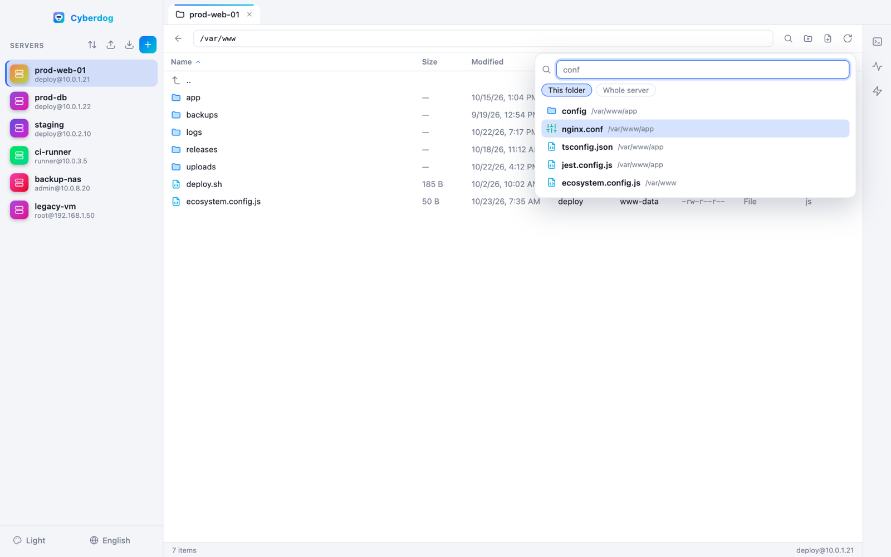

**Extract archives in place**: right-click a `.zip`, `.tar.gz`, `.tgz`, `.tar.bz2`, `.tar.xz`, `.7z`, `.rar`, `.gz`… and choose *Extract here* or *Extract to "name/"* — it runs on the server, nothing is downloaded.

**Split view**: the ⧉ button in the explorer toolbar splits it into **two independent explorers** (own path, history, selection, sort and search) to compare folders or work in two places at once. Drag files from one side to the other to copy them, even across folders. Click ⧉ again to merge.

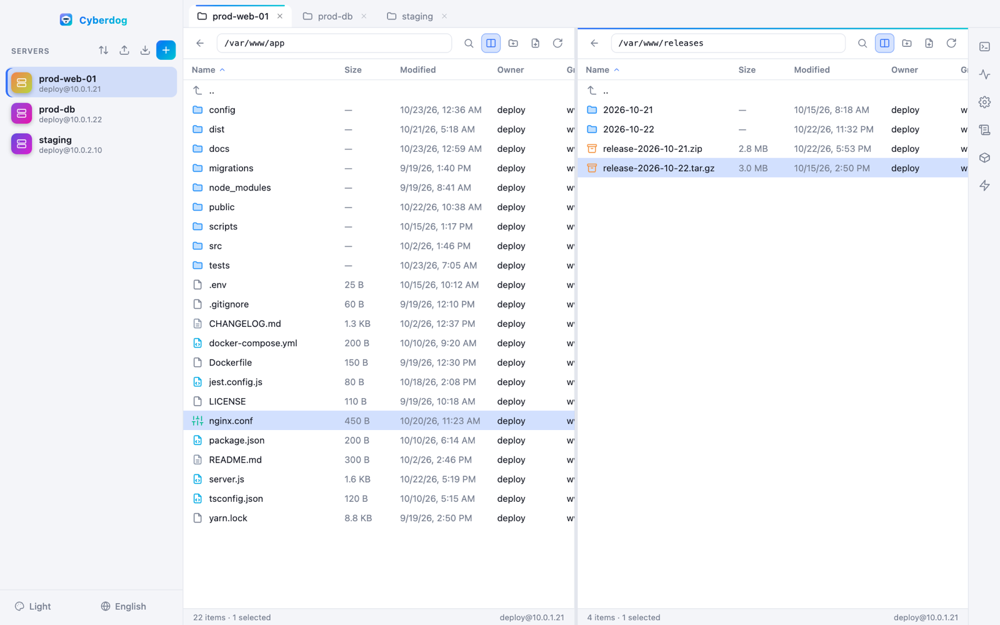

**Drag & drop** files from your desktop to upload them (folders included), or drag files from Cyberdog to your desktop to download them.

**Everything is resizable**: drag the edge of the server list, of the right-hand panel, of the terminal or between the two explorers. Sizes are remembered.

### Permissions and ownership

Right-click a file or folder and choose **Permissions…** to see the current owner and select another account from the server. The octal mode (`0644`, `0755`…) stays synchronized with **Read / Write / Execute** checkboxes for owner, group and others. Special `setuid`, `setgid` and `sticky` bits are available too.

The file group is preserved. Changes use your SSH account’s permissions; denied ownership changes and partially applied changes are reported.

### Terminal, right where you work

The terminal opens under the explorer, starts in the current folder and stays open while you switch panels. Drag the splitter to resize it.

### Server health dashboard

Click the 📈 button in the right-hand toolbar (the terminal, health, services, logs, Docker and quick-action buttons all live there). Every 10 seconds you get:

- **Online / offline** status and the time of the last check
- **CPU, memory, swap and system load**
- **Disk space per volume** with warnings at 80 % and critical alerts at 90 %
- **Uptime, SSH latency and connection time**, plus a history of recent checks

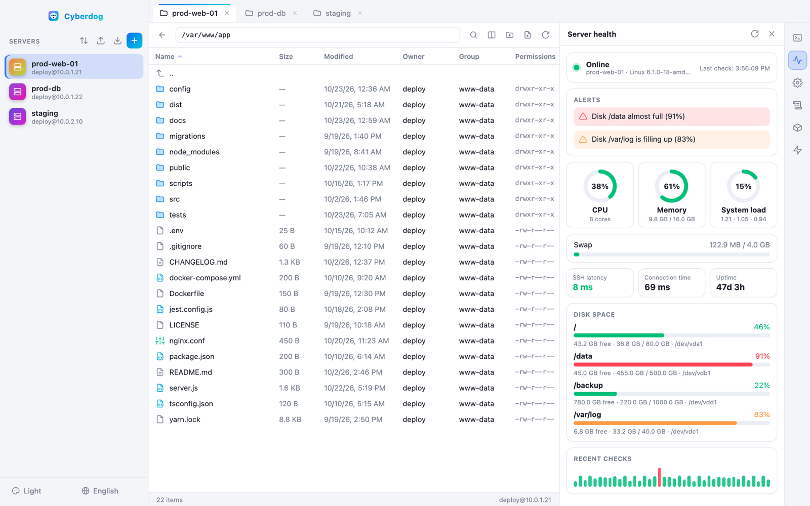

### Process Explorer

The right-hand **Process Explorer** shows Linux processes over SSH without an agent. It refreshes every 5 seconds, with search and grouping by program, parent tree, user, systemd service or container. CPU/memory trends use observed samples for up to 5 minutes, flagging CPU spikes, memory growth, zombies and uninterruptible I/O waits.

On-demand details show listening ports, working directory and command. Local rules provide a guided diagnosis. The context menu opens logs or an SSH terminal and offers **SIGTERM / SIGKILL**, with confirmation. Available details depend on permissions; Linux `/proc` and `procps` are required, `ss` supplies ports and the systemd journal supplies logs.

Right-hand panels resize down to a minimum of **290 px**, with their width remembered between launches.

### SSL certificates and SSH keys

The far-right navigation can be **expanded or collapsed** to show view titles; its state is remembered.

**SSL certificates** scans PEM/DER certificates over SSH in the Let’s Encrypt, nginx, Apache and `/etc/pki/tls/certs` directories, or an absolute directory you choose. The server needs OpenSSL. The view shows domains, issuer, file locations, SHA-256 fingerprint and validity dates. Duplicate certificates are grouped by fingerprint. A limited scan is flagged so you can select a more specific directory.

Expiry alerts can be set to **7, 14, 30, 60 or 90 days**, with separate states for expired and not-yet-valid certificates. Scans repeat every minute while the view is open; the latest scan’s alerts also appear in the health dashboard. No monitoring runs when the app is closed. **Use sudo** accesses protected directories according to the connected account’s privileges.

**Renew with Certbot** is available for certificates managed under `/etc/letsencrypt/live` when Certbot is installed. It reuses existing configuration and hooks, without forcing early renewal. Command output is shown and certificate dates are refreshed afterwards. See the [Certbot documentation](https://eff-certbot.readthedocs.io/en/stable/using.html#renewing-certificates).

**SSH key manager** generates local **Ed25519** or **RSA 4096** keys, with an optional passphrase, in `~/.ssh/cyberdog`. Import an existing `.pub` file, display or copy the public key and SHA-256 fingerprint, or reveal the local file. Private keys are never sent to the server.

**Install on this server** appends the public key to the connected account’s `~/.ssh/authorized_keys`, preserving existing keys and avoiding duplicates. **Use for this server** selects the local private key for future connections without interrupting the current connection. Required passphrases are requested and kept only in memory until the app closes.

The SSH key manager also lists public keys authorized on the current server from `~/.ssh/authorized_keys`, with their SHA-256 fingerprints. These are shown separately from locally managed keys. Reading requires permission on the remote file; private keys are never read from the server.

### Services

The ⚙️ button lists your `systemctl` services with their state, a search box and filters (running / failed / stopped). Start a stopped service, restart or stop a running one — `sudo` is handled for you when you are not root — or jump to its logs in one click.

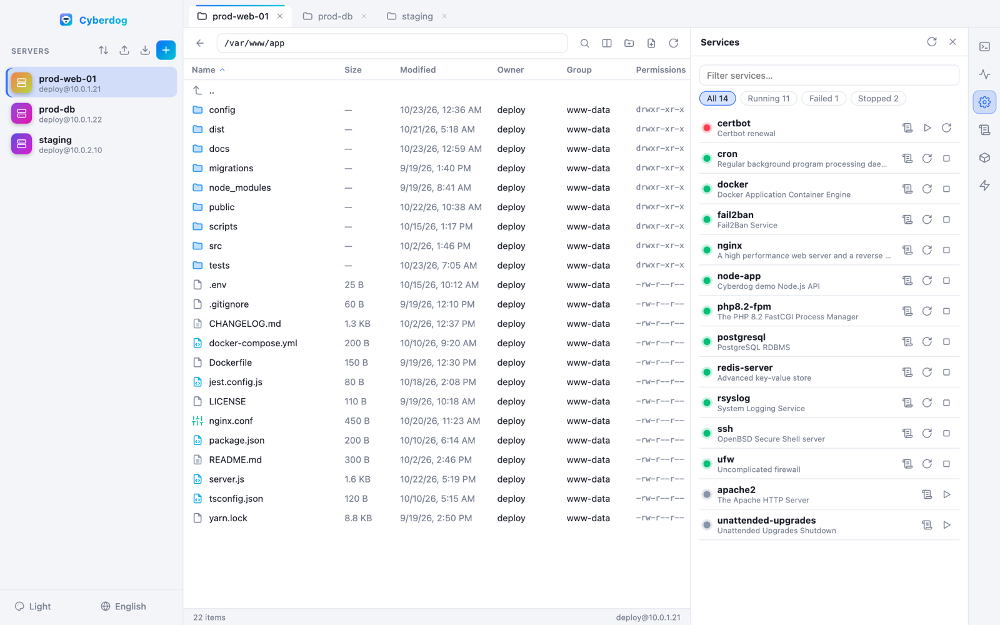

### Live logs

The 📜 button follows your logs in real time: the **system journal** (`journalctl -f`), a **single unit**, **Nginx** error/access logs, `syslog`, `auth.log` or **any file**. Filter by text and by level, see errors and warnings **highlighted** (with counters), pause by scrolling, and keep **favorite searches** one click away.

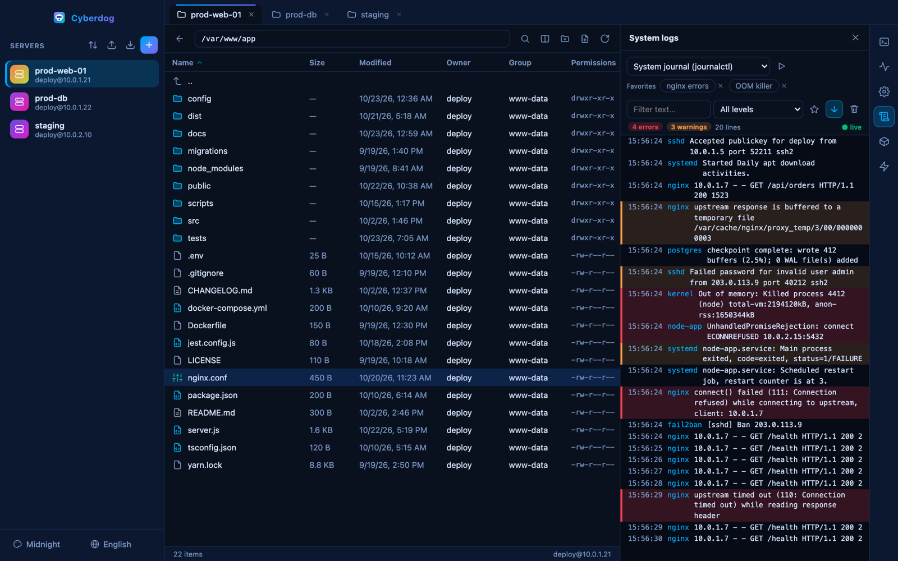

### Docker

The 📦 button lists your containers with live **CPU / RAM usage**, lets you **start, stop and restart** them, **tail their logs live** and **inspect** containers and images (ports, mounts, env, layers…). Ideal when your servers host containerized apps.

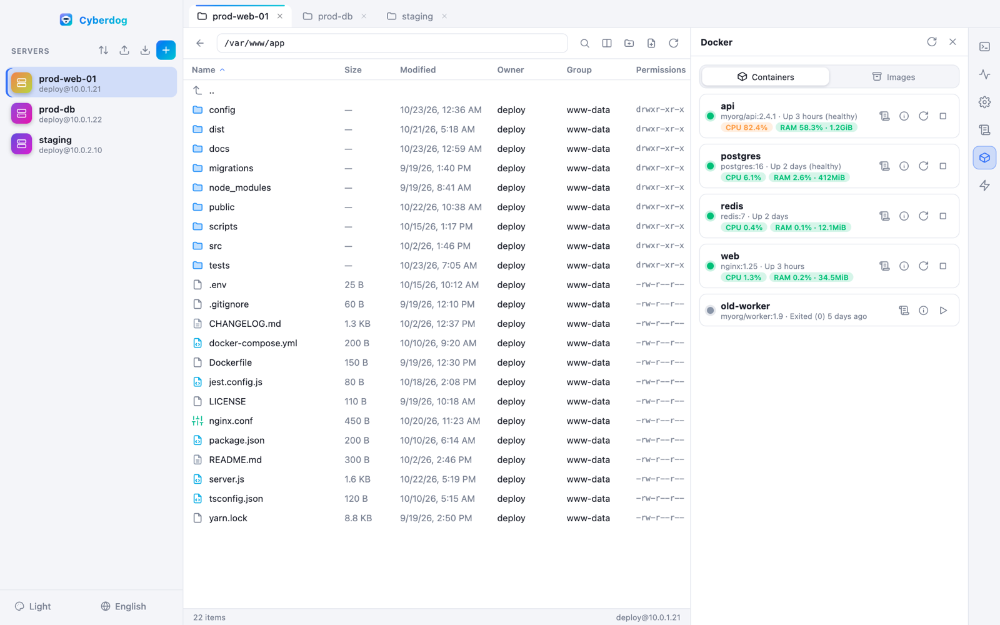
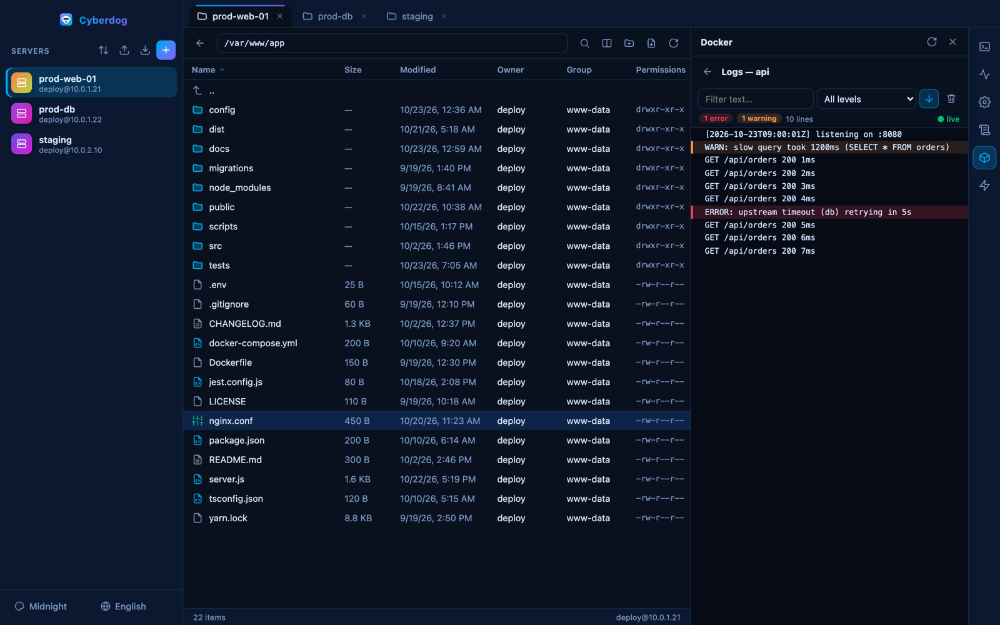

### Quick actions

Save your everyday bash snippets (restart a stack, clean logs, disk report…) next to your servers. Run one on the current server, or on **every open server at once**, and read each output right in the panel. Export your actions to a zip and share them with your team.

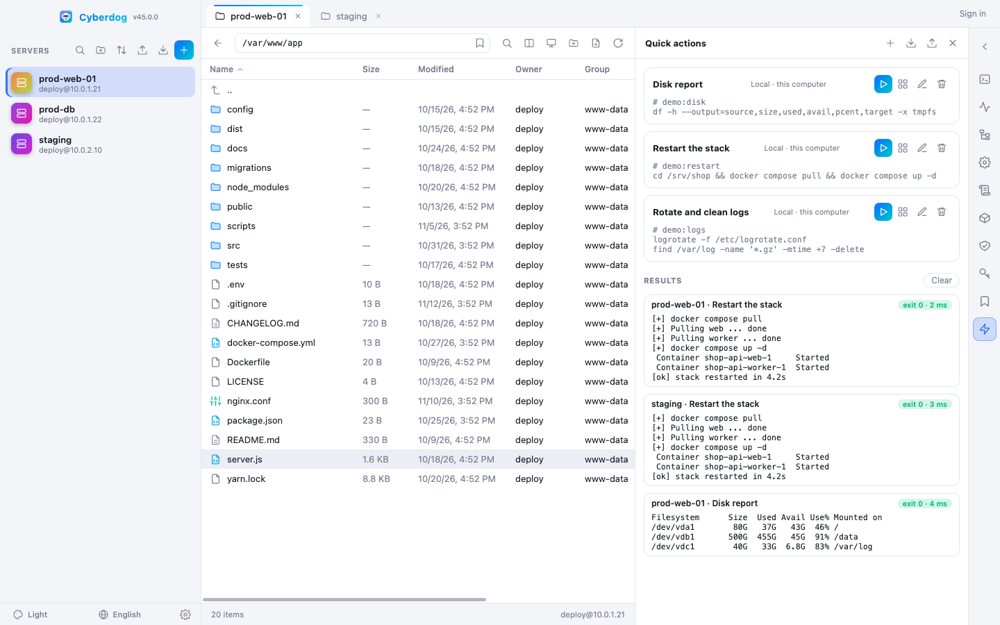

**Cyberdog commands.** A line printed by an action drives the app once the script has run: `cyberdog:download /path` downloads a file to this computer, `cyberdog:open /path` opens a file in the editor or a folder in the explorer, `cyberdog:terminal [/path]` opens the terminal, `cyberdog:refresh` refreshes the explorer, `cyberdog:notify text` shows a message, `cyberdog:url https://…` opens a link.

**Actions that ask.** Print a form and stop; Cyberdog shows it, then runs the script again with each answer in its variable:

```bash
if [ -z "$FILE" ]; then
  echo "cyberdog:title Download a log"
  echo "cyberdog:select FILE|Application"
  echo "cyberdog:option FILE|/app/log/wildfly-ideophm/debug.log|ideophm"
  echo "cyberdog:option FILE|/app/log/wildfly-ideolink/debug.log|ideolink"
  exit 0
fi
echo "cyberdog:download $FILE"
```

`cyberdog:input VAR|Label|default` asks for text and `cyberdog:buttons VAR|Question|Yes=yes|No=no` shows buttons. Actions can be made for a single server, and a right-click on a server lists its actions to run them directly.

### Transfer manager and remote navigation

The explorer footer shows the current upload or download. Hover over it or click it to see concurrent transfers, byte progress, transfer speed, approximate remaining time, cancellation and recent results. Folder transfers include nested files. Cancelling can leave a partial destination file; completed files are kept. Recent transfer history is held in memory and can be cleared.

The path field supports `~` and `~/…` for the connected user’s home directory. Entering a file path opens its parent folder and selects that file. Saved paths are available immediately after startup, including in the path dropdown.

### Themes & languages

System, Light, Dark, Midnight, Dracula, Forest and Sunset — the terminal follows. The interface is available in **14 languages**: English, Français, Deutsch, Italiano, Español, Português, 中文, العربية (right-to-left), हिन्दी, Русский, 日本語, 한국어, Türkçe and Bahasa Indonesia.

<table>
  <tr>
    <td>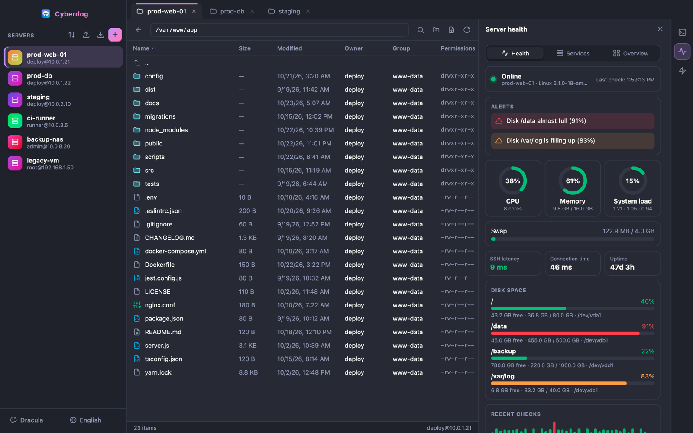</td>
    <td>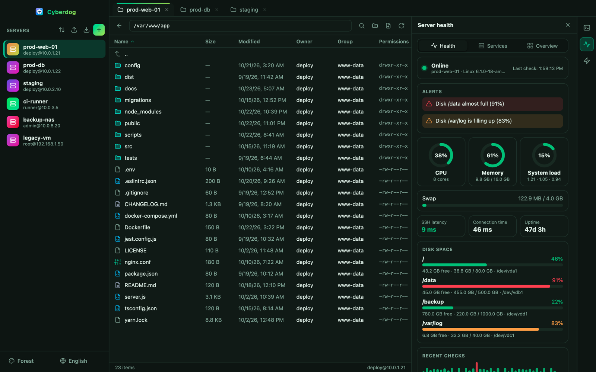</td>
    <td>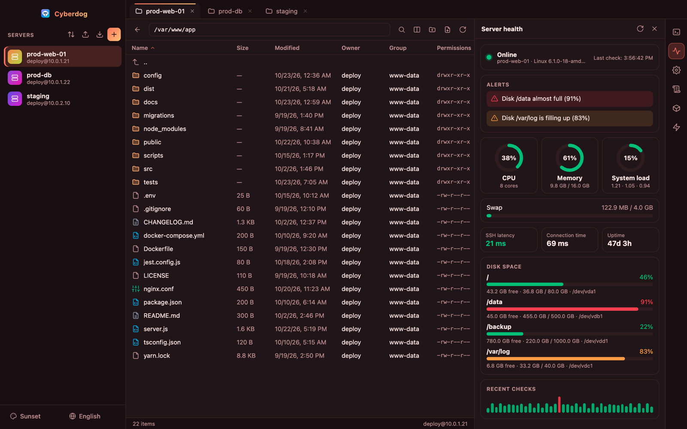</td>
  </tr>
</table>

---

## 🔒 Security & privacy

- Passwords are **encrypted with your OS keychain** (macOS Keychain, Windows DPAPI, Linux secret service) and never leave your machine. Exports never contain passwords or host fingerprints.
- **Host keys** are pinned on first connection (trust on first use); a changed key blocks the connection until you accept it.
- `sudo` passwords are sent over the encrypted SSH channel on stdin, never on a command line.
- No telemetry. Configuration stays local; the optional account stores only the metadata you explicitly share with a team on Supabase.

Configuration lives in:

| | |
|---|---|
| macOS | `~/Library/Application Support/Cyberdog/` |
| Windows | `%APPDATA%\Cyberdog\` |
| Linux | `~/.config/Cyberdog/` |

(`servers/` and `actions/` hold one JSON file per item, `settings.json` holds language and theme.)

---

## 🛠️ Build from source

Requirements: [Node.js](https://nodejs.org) 22+.

```sh
git clone https://github.com/pickywawa/cyberdog.git
cd cyberdog
npm install

npm start          # run the app
npm test           # unit tests
npm run dist:mac   # macOS .dmg (arm64 + x64)   — run on a Mac
npm run dist:win   # Windows installer + portable — run on Windows
npm run dist:linux # Linux AppImage + .deb       — run on Linux
```

Installers are written to `dist/`. Icons are generated from `src/assets/icon.svg` with `npm run icons` (macOS).

### Releases (CI/CD)

| Workflow | Trigger | What it does |
|---|---|---|
| [`ci.yml`](.github/workflows/ci.yml) | every push / pull request | runs the tests on Linux and macOS |
| [`release.yml`](.github/workflows/release.yml) | tag `v*` (or manual run) | runs the tests, builds the macOS, Windows and Linux installers and publishes the GitHub release with `SHA256SUMS.txt`. macOS builds are signed with a Developer ID certificate and notarized when the Apple secrets are set; forks without them get unsigned builds |

To publish a new version:

```sh
npm version patch        # or minor / major: bumps package.json and creates the v* tag
git push --follow-tags   # tests, builds, signs (macOS) and publishes the GitHub release
```

The signing certificate, the notarization key and the GitHub secrets are described in [docs/release-signing.md](docs/release-signing.md).

---

## 🧱 Tech

Electron · [ssh2](https://github.com/mscdex/ssh2) (SFTP, shell, exec) · [xterm.js](https://xtermjs.org) · plain HTML/CSS/JS (no framework, no bundler).

```
src/main.js        main process: SSH/SFTP, storage, IPC
src/renderer.js    explorer, tabs, terminal, search
src/panels.js      health dashboard, quick actions
src/ops.js         services, live logs, Docker
src/archive.js     archive detection + extraction commands
src/health.js      remote health script + parsers
src/i18n.js        translations (EN/FR/DE/IT)
```

## 🌐 Website

The bilingual showcase is hosted at [pickywawa.github.io/cyberdog](https://pickywawa.github.io/cyberdog/). Its static files live in [site/](site/), deployed by GitHub Actions when those files change on main. Preview locally with `python3 -m http.server 8765 --directory site`. The comparison pages (Cyberduck, Termius, WinSCP, in English and French) and the sitemap are generated by `python3 tools/build-compare-pages.py` from [tools/compare_data.py](tools/compare_data.py): edit the data there, then run the script.

## 📰 Release notes

Every version is on the [GitHub releases](https://github.com/pickywawa/cyberdog/releases) page.

### 1.14.0

- **Click to rename**: click the name of the selected file again to rename it (the name is selected without its extension, as in the Finder). F2 and right-click > Rename still work.
- **Show in Finder / Explorer**: the "Downloaded" notification and the finished downloads of the transfer list have a button that shows the file on your computer, as browsers do. The transfer list also gives the start and end times and how long each transfer took.
- **Actions for one server**: an action can be made for a single server ("Available for" in its form). It is shown only on that server and exported with it.
- **Right-click a server > Actions**: run any of its actions directly (the server opens on its Actions view), or create one.
- **Cyberdog commands in actions**: a line printed by a script can download a file (`cyberdog:download`), open a file or a folder (`cyberdog:open`), open the terminal (`cyberdog:terminal`), refresh the explorer, show a message or open a web link.
- **Actions that ask**: `cyberdog:select`, `cyberdog:input` and `cyberdog:buttons` show a form (list, text, buttons); the script then runs again with the answers in its variables. Example: pick a log in a list, then download it. Everything is explained with the ⓘ button of the Actions view.
- **Bigger action editor**, with a button that enlarges it to the whole window.

### 1.13.1

- **One tab per double-click**: double-clicking a server in the list opens it once, not twice.
- **Back where you were**: a server you open again comes back at the last folder you were in (home if that folder is gone).

### 1.13.0

- **Built-in editor**: double-click (or Enter) opens a file in an editor inside Cyberdog, the one of VS Code (Monaco): syntax colours for about 80 languages, search and replace, multiple cursors, VS Code shortcuts. Several files at once in tabs (when they do not fit, a list at the end of the bar gives them all), split in two, minimap and line-wrap buttons, ⌘S / Ctrl+S to save, ⌘W / Ctrl+W to close. Files keep their encoding (UTF-8 with or without BOM, UTF-16, Windows-1252) and their line endings; a file changed on the server meanwhile is never overwritten without asking. Binary files and files over 10 MB open in your usual application, which you can still choose in Settings > Editor.
- **Transfer queue**: up to 10 transfers at the same time (Settings > General), pause and resume, priorities, reorder, retry failed transfers, Queue / Failed / Done tabs. Downloads can be added to the queue without starting.
- **File already there**: overwrite, overwrite if newer, if the size differs, resume, keep both or skip, with "do the same for the next files".
- **Copy, cut and paste files** (⌘C / ⌘X / ⌘V, Ctrl on Windows and Linux) between folders, panes and servers; duplicate (⌘D); Move to…; drag onto a folder to move, from one pane to another to copy directly between servers.
- **Explorer**: clickable path (click a folder to go there, click the current one or ⌘L to type a path), Upload button, discreet name filter (`*.log, node_modules`, hidden files), Properties (⌘I) with the size of a folder, Copy URL, symbolic links (SSH), permissions applied to a whole folder (files only or folders only), open a folder in a new tab, Tab to go from pane to pane, type the start of a name to select it.
- **Reopen connections at startup** now brings each tab back at its folders, split view included.

### 1.12.0

- **Create archives** ([#2](https://github.com/pickywawa/cyberdog/issues/2)): right-click > Compress > `.tar.gz` or `.zip` on one or more items (SSH servers). The archive is created on the server, next to the selection; an existing file is never overwritten.
- **Refresh after editing** ([#3](https://github.com/pickywawa/cyberdog/issues/3)): when a file opened from Cyberdog is saved and sent back, the list showing its folder refreshes, so size and date are current right away.
- **Faster folder changes** ([#4](https://github.com/pickywawa/cyberdog/issues/4)): opening a folder already listed (double-click, `..`, back, refresh) takes one round trip to the server instead of four.

### 1.11.0

- **Keyboard shortcuts** ([#1](https://github.com/pickywawa/cyberdog/issues/1)): ⌘R / Ctrl+R or F5 refreshes the list; arrows and Shift+arrows move and extend the selection, Enter opens, ⌘↑ goes to the parent folder, ⌘[ goes back, ⌘A selects all, F2 renames, ⌘⌫ / Delete deletes, ⇧⌘N and ⌥⌘N create a folder or a file, ⌘L edits the path, ⇧⌘C copies the path. Tabs: ⌘1…9, Ctrl+Tab, ⌘W; Ctrl+` toggles the terminal. ⌘/ (or the keyboard button in the sidebar) lists them all. On Windows and Linux, ⌘ is Ctrl; inside the terminal, Ctrl keys stay with the shell.

### 1.10.1

- **Signed macOS releases:** the macOS apps are signed with an Apple Developer ID certificate and notarized, so they open without a Gatekeeper warning. They are also available with Homebrew: `brew install --cask pickywawa/cyberdog/cyberdog`.
- **Bastions:** the route test works again. Since 1.8.0 it stopped at the first step.

### 1.10.0

- **14 interface languages:** ten more (Spanish, Portuguese, Chinese, Arabic with right-to-left layout, Hindi, Russian, Japanese, Korean, Turkish and Indonesian), with their plural rules.
- **Resizable explorer columns.**
- **Accounts:** e-mail verification at sign-up and a code at each sign-in. You can now **delete your account** from *Settings → Sign in*.

### 1.9.0

- **Linux:** AppImage and `.deb` releases.

Earlier notes:

<details>
<summary>Versions 1.6 to 1.8</summary>

#### New in 1.8.0: everything free, with accounts and teams

Every feature is free. Sign in is optional and only needed for teams: create an account with your e-mail address in **Settings → Sign in**, create a team, then invite colleagues with an **invitation link** (valid 7 days, one or several uses, revocable). Permissions are verified server-side from your Supabase session for every operation. SSH passwords and keys stay local unless you choose to sync them for a shared server. Secret vaults and SSH bastions work without an account. The former Premium preview and its licensing have been removed.

#### New in 1.7.0

- **New server types:** SMB / Windows shares (through the system's own SMB client: `mount_smbfs` on macOS, UNC paths on Windows), Azure Files, Dropbox, OneDrive and Google Drive (OAuth sign-in in your browser; enter the client ID of your own application, or use the one bundled by the maintainers).
- **WebDAV:** Digest and Bearer-token authentication, automatic scheme detection, same-origin redirects, and an option to accept untrusted certificates.
- **Proxy:** FTP, S3, Azure, WebDAV and the cloud drives can go through an HTTP (CONNECT) or SOCKS5 proxy, with optional credentials (Options tab).
- **Local pane:** a button next to the split button opens this computer's files beside the server. Hidden by default: enable it in Settings → General. Dragging files between the panes uploads and downloads; deleting in the local pane sends files to the Trash.
- **Resume interrupted transfers:** a failed or cancelled transfer keeps its plan; **Resume** skips finished files and continues the partial one where both ends allow it (SFTP, FTP, local, SMB and ranged downloads from every protocol; object-storage uploads restart that file). Unfinished transfers survive a restart.
- **Server-to-server copy** from the context menu (**Copy to another server…**), connection to connection without staging files on disk.

#### Also in 1.7.0: protocols and teams preview

- **FTP:** streamed uploads (progress follows the network), Unix permissions (owner, group, mode columns and **Permissions…** through `SITE CHMOD`), and import of FTP/FTPS sites from FileZilla, WinSCP and Cyberduck.
- **S3:** AWS profiles from `~/.aws` (static keys, `credential_process`, IAM Identity Center after `aws sso login`, role assumption) or environment variables, automatic bucket-region detection, and **Copy shared link** (presigned URL, up to 7 days).
- **Azure:** Microsoft Entra ID sign-in (service principal secret, device code for your app registration, or Azure CLI `az login`) and **Copy shared link** (read-only SAS) for account-key servers.
- FTP and Azure now have automated tests (an in-process FTP/FTPS server and the Azurite emulator).

#### New in 1.7.0-beta.3

- **FTP / FTPS:** new server type with explicit or implicit TLS, an option to accept self-signed certificates, and up to three parallel control connections so browsing continues during transfers.
- **S3 providers:** presets for Google Cloud Storage, Backblaze B2, Wasabi, DigitalOcean Spaces and Scaleway.
- **S3 improvements:** optional session token (temporary credentials, stored encrypted), multipart upload for files above 64 MB, and virtual-hosted addressing (`bucket.host`).
- **Azure Blob Storage:** new server type using an account key (SharedKey) or a SAS token; large files are sent as block lists.

#### New in 1.7.0-beta.2

- Teams modules: personal space, team servers, shared groups/actions/paths, permissions and server revision restoration.
- Ten local vault connectors, including TeamPass, Keeper Secrets Manager, Password Manager Pro, Devolutions Server and Windows RDM. See [requirements and limits](docs/secret-vaults.md).
- Settings with left navigation, theme-matched backgrounds, branded vault picker and save icon.

#### New in 1.6.3

The right panel can be narrowed to 290 px (about 60% of its previous minimum width). Drag its left edge to resize it; your chosen width is remembered.

#### New in 1.6.2

- **Optional session restoration:** enable **Reopen connections at startup** in Settings → General to reopen server tabs and terminals left open when quitting. Disabled by default; terminal commands are never replayed. Only references to configured servers and terminal visibility are stored. Deleted servers are skipped, and disabling the option removes the saved session.
- **Shared saved paths:** the saved-path dialog includes **Available on all servers**, unchecked by default when saving from the explorer. Check it to share the path across servers; leave it unchecked to keep it on the current server. You can also change this scope when editing an existing saved path.
- **New website:** discover Cyberdog, browse screenshots and download the latest macOS or Windows build at [pickywawa.github.io/cyberdog](https://pickywawa.github.io/cyberdog/). The site supports French and English, mobile layouts, an interactive gallery and reduced-motion preferences.

</details>

## 📄 License

[MIT](LICENSE) © pickywawa
