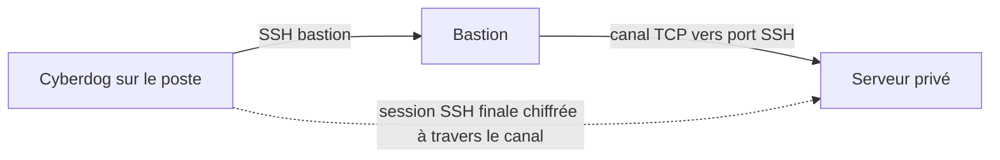

# Bastions SSH — étude, spécification et plan Cyberdog

> **Mise à jour :** cette spécification est implémentée dans Cyberdog et gratuite. Le placement « Premium » évoqué plus bas a été abandonné avec la suppression des licences. La description de la fonction pour les utilisateurs se trouve dans la section « Bastions » du [README](../../README.fr.md).

Statut : proposition de conception, sans implémentation réseau. Recherche documentaire et inspection du code le 27 octobre 2026. Les produits concurrents n’ont pas été installés ni testés pour cette étude. Les fonctionnalités ci-dessous sont celles documentées par leurs éditeurs, sans affirmation sur les tarifs ou éditions non vérifiés.

Livrables : [maquette interactive](./maquette.html), [capture Dracula](./maquette.png), [plan de développement et recette](./plan-developpement.md).

## 1. Décision proposée

Intégrer un accès SSH à travers **un bastion réutilisable**, sélectionné parmi les serveurs enregistrés. Aucun agent Cyberdog à installer, aucune clé privée copiée sur le bastion, aucune ouverture de port local pour réaliser ce saut. Tous les usages SSH de la cible empruntent la même route : fichiers, terminal, actions, monitoring et outils serveur.

Hypothèse produit : composant Premium privé, cohérent avec les espaces partagés et coffres existants. Ce placement commercial reste une proposition ; aucune modification de licence ou de paiement dans cette étude. Les connexions directes existantes restent compatibles.

Le premier lot opérationnel couvre un bastion local, puis un second lot apporte le même fonctionnement aux espaces personnels et équipes. La publication de la fonction partagée dépend de la migration et des contrôles serveur : ne pas afficher une option de partage qui ignorerait la route.

## 2. À quoi cela sert, précisément

Cas principal : une seule machine est joignable depuis le poste utilisateur ; elle peut joindre les ports SSH des machines privées. Cyberdog établit SSH vers le bastion, ouvre un canal TCP vers la cible, puis établit **une deuxième session SSH depuis le poste** dans ce canal.



Le bastion voit la destination et les métadonnées réseau, mais la session SSH finale reste chiffrée entre le client et la cible. Il ne reçoit pas la clé privée finale. Le bastion ne confère aucun droit d’accès à la cible : celle-ci authentifie toujours l’utilisateur. Les commandes ne sont pas automatiquement auditées par un bastion de transport.

Le nom de la cible est résolu depuis le bastion lors de l’ouverture du canal ; seul le nom du premier bastion doit être résolu depuis le poste. Une cible `127.0.0.1` est le loopback du bastion, ce qui doit être signalé dans le formulaire. Le passage peut fonctionner sans VPN si les règles réseau le permettent, mais ne contourne ni pare-feu, ni politique de l’entreprise.

Référence : [OpenSSH ProxyJump](https://man.openbsd.org/ssh_config#ProxyJump).

## 3. Comparatif documentaire

| Produit | Options attestées | Intérêt pour Cyberdog / réserve |
|---|---|---|
| [OpenSSH](https://man.openbsd.org/ssh_config#ProxyJump) | `ProxyJump` : hôte ou liste ordonnée de sauts, utilisateur et port ; configuration du saut indépendante de la destination ; interaction avec `ProxyCommand`. | Référence du modèle de transport. Reprendre la distinction des identités ; ne pas exécuter de commande arbitraire importée. |
| [Termius](https://docs.termius.com/organize-and-connect-to-hosts/connecting-to-a-server#connect-through-jump-hosts) | Host Chaining dans la fiche ; sélection ou création de plusieurs hôtes intermédiaires ; chaîne définissable sur un groupe et héritée par ses hôtes. | Réutilisation très proche du besoin ; retenir le sélecteur, différer chaînes et héritage pour réduire les dépendances implicites. |
| [SecureCRT](https://www.vandyke.com/products/securecrt/securecrt-video.html) | L’éditeur documente « Dependent Sessions » : relier la connexion finale à une session de passerelle pour joindre un hôte situé derrière elle. | Référencer une session existante plutôt que recopier ses paramètres ; cette source n’établit pas une limite de sauts. |
| [Cyberduck](https://docs.cyberduck.io/protocols/sftp/) | Prise en compte de `ProxyJump` dans la configuration OpenSSH pour SFTP ; aliases, IdentityFile, IdentityAgent, PreferredAuthentications et IdentitiesOnly documentés ; empreintes et connexion interactive. | Bonne interopérabilité, mais réglage moins découvrable que notre sélecteur visuel. La documentation exige une correspondance correcte du nom/alias du favori. |
| [WinSCP](https://winscp.net/eng/docs/ui_login_tunnel) | Onglet Tunnel : case d’activation, hôte/utilisateur, clé privée propre au tunnel, port local choisi ou automatique. Les sauts complexes/multiples nécessitent un outil externe selon cette page. | Configuration compréhensible ; éviter la duplication de la passerelle et le port local superflu pour notre moteur natif. |
| [MobaXterm](https://mobaxterm.mobatek.net/documentation.html#4_10) | Réglage réseau « SSH gateway (jump host) » ; le terminal et le navigateur SFTP suivent le passage. [Page des fonctions](https://mobaxterm.mobatek.net/features.html) : passerelle aussi pour d’autres protocoles et gestionnaire de tunnels séparé. | Retenir une route commune aux fonctions, tout en séparant bastion et futurs tunnels applicatifs. Ne pas extrapoler la prise en charge de plusieurs sauts depuis cette documentation. |
| [Royal TS](https://docs.royalapps.com/r2023/royalts/reference/gateways/securegateway.html) | Objet Secure Gateway réutilisable, test, identifiants référencés, préférence keyboard-interactive, agent SSH, empreinte et passerelle dépendante pour les chaînes. | Modèle de réutilisation et de séparation des secrets pertinent. Plus riche et plus complexe que le besoin initial. Documentation de la branche r2023, pas promesse de parité de chaque version TS/X. |
| [Royal TS : usage d’une passerelle](https://docs.royalapps.com/r2023/royalts/reference/connections/web-page-chrome.html) | Pour ce type de connexion documenté : héritage du dossier, modes Never/Always/On Demand. | Héritage envisageable ensuite. Refuser un repli direct automatique dans Cyberdog afin de conserver un trajet prévisible. Ne pas généraliser cette page web à tous les protocoles du produit. |
| [Devolutions RDM](https://devolutions.net/blog/how-to-configure-a-secure-gateway-in-remote-desktop-manager/) | Guide officiel : entrée SSH Tunnel en mode dynamique, sélection dans VPN/SSH/Gateway, options d’ouverture/fermeture ; exemples RDP et navigateur. | Cycle de vie et objet partagé intéressants. Le guide date de 2020 ; ce n’est pas une validation de l’interface actuelle. Ne pas confondre avec RDM Jump/RDM Agent ni Devolutions Gateway. |

Les options non précisées dans ces pages (limites exactes de sauts, parité entre toutes les plateformes, tarifs/éditions) restent non établies. Le tableau compare les mécanismes documentés, pas un classement commercial.

### Synthèse produit

Retenir la réutilisation d’une entrée (Termius, Royal TS, SecureCRT), l’application automatique au terminal et SFTP (MobaXterm), et les identités distinctes d’OpenSSH. Ajouter ce qui correspond au besoin Cyberdog : un diagnostic lisible du trajet, la transparence sur les secrets personnels et les droits d’équipe. Écarter du premier lot les matrices de paramètres cryptographiques, commandes proxy, gestionnaire de ports et dépendances implicites de dossiers.

## 4. Périmètre et ergonomie

### Fiche serveur

Après les champs d’adresse et d’utilisateur, une section **Accès réseau** : choix « Direct » / « Via un bastion ». Direct par défaut. Via ouvre un sélecteur recherchable parmi les serveurs compatibles, avec nom, adresse, utilisateur indicatif, emplacement et provenance coffre éventuelle.

- L’entrée cible est exclue de la liste ; un serveur possédant déjà une route est désactivé dans la V1 à un saut, avec explication.
- Le sélecteur référence l’entrée par identifiant stable, jamais par son nom.
- Boutons « Ajouter un serveur bastion » et « Modifier » : formulaire secondaire, puis retour sans perdre la cible en cours de saisie. Annuler le secondaire conserve les valeurs initiales.
- Un aperçu montre « Ce poste → Bastion production → API production », avec adresses et ports dans les détails.
- Le groupe de classement et l’emplacement Local / Mon espace / Équipe restent indépendants de la route réseau.
- Le formulaire ne duplique pas les secrets du bastion. Les identifiants de chaque saut sont résolus séparément.
- Mode authentification bastion : « identifiants configurés », agent local, ou « demander à la connexion » via sa fiche. Pour les entrées partagées, afficher clairement « Vos identifiants sur cet ordinateur ».
- Une petite option « Utilisé comme bastion » permet de filtrer les entrées sans en faire un nouveau type de connexion incompatible. Un serveur ordinaire peut être choisi ; cette option est une aide de classement, pas une permission.

### Ouvrir une cible

Simple clic conservé. Pendant l’ouverture, le **panneau central** présente le loader Cyberdog et l’étape actuelle. Le bastion technique n’ouvre pas un onglet supplémentaire. Après connexion, une indication discrète « via Bastion production » permet d’inspecter le trajet et de se déconnecter. Aucun nouveau panneau latéral obligatoire.

### Tester le trajet

Teste le formulaire non enregistré, après validation des champs. Un test est temporaire et ne sauvegarde pas la fiche ; l’acceptation explicite d’une empreinte peut sauvegarder la confiance locale, annoncée dans la boîte de dialogue.

Étapes : configuration et droits → connexion/authentification bastion → canal vers la cible → connexion/authentification cible → capacité SFTP. Distinguer « SSH accessible, SFTP indisponible » d’un échec de route. Aucun script distant ni terminal interactif exécuté par le test.

Le test ne prouve que ce que le serveur permet d’observer. Un échec `forwardOut` peut recouvrir DNS, refus réseau ou politique SSH ; ne pas annoncer une cause précise sans preuve. Afficher le code connu et des vérifications possibles, sans inventer un diagnostic.

Actions : Annuler, Réessayer (nouvel essai explicite), Copier un résumé expurgé. Fermer la fiche annule et libère toutes les ressources du test. Un identifiant de tentative empêche un événement tardif de modifier la tentative suivante.

### États à couvrir

| État | Comportement |
|---|---|
| Pas de bastion disponible | État vide et création ; sauvegarde Via impossible tant qu’une référence n’est pas choisie. |
| Bastion supprimé/inaccessible | Route invalide visible ; aucun repli direct. Remplacer le bastion explicitement. |
| Première empreinte | Fenêtre avec rôle bastion/cible, nom, endpoint et SHA-256 ; Accepter / Annuler. |
| Empreinte modifiée | Blocage ; ancienne et nouvelle empreinte ; remplacement dans une action dédiée après vérification indépendante. |
| Authentification interactive/MFA | Fenêtre nommant le saut, instructions, tous les champs et propriété echo. Aucun code conservé. |
| Refus de forwarding | Message de canal refusé et vérifications AllowTcpForwarding / PermitOpen ; pas de tentative de shell de secours. |
| Annulation/MFA expiré | Nettoyage, statut annulé/expiré ; aucun essai silencieux du mot de passe pour chaque question. |
| Perte du bastion | Toutes les connexions de cette tentative ferment ; transferts passent en erreur/annulés ; conserver le terminal affiché sans rejouer les commandes. |
| Paramètres modifiés en session | Ne pas rerouter une session active silencieusement ; nouveau trajet appliqué à la prochaine ouverture. Révocation de droits ou coffre verrouillé : fermeture active. |
| Redémarrage application | Restaurer les références si l’option existante est activée ; authentification/MFA redemandées ; aucune donnée de défi sauvegardée. |

Maquette : ses états sont simulés et indiqués comme tels. Le succès simulé n’est pas une preuve de connectivité.

## 5. Modèle de données proposé

Extension versionnée d’une fiche serveur :

```json
{
  "id": "server-api",
  "host": "api.internal",
  "port": 22,
  "user": "deploy",
  "networkAccess": {"version": 1, "mode": "bastion", "bastionId": "server-jump"}
}
```

Absence du champ = direct pour la rétrocompatibilité. À l’écriture, normaliser Direct en `{version:1,mode:"direct"}` ou absence selon le format choisi une fois pour toutes ; ne jamais laisser une ancienne référence active. Champs inconnus, versions non reconnues, identifiants invalides, modes et ports incohérents refusés par le processus principal et le backend partagé. Pas d’hôte de repli embarqué avec la référence.

Le marqueur facultatif `isBastion` est une métadonnée de présentation. Une empreinte n’est pas partagée comme une preuve de confiance : elle reste validée localement, par identité de connexion et contexte (scope, ID stable, hôte normalisé, port ; pour la cible, référence de route). Tout changement d’endpoint invalide la liaison de confiance. Ne pas stocker la confiance d’un test non enregistré dans la fiche au moyen d’un nom temporaire ambigu.

Les profils de secrets sont locaux : clé privée/chemin, mot de passe, session de coffre et préférences d’agent. Une identité SSH partagée peut être fournie comme valeur par défaut ; l’utilisateur peut avoir une surcharge locale d’identité, liée au serveur et à son endpoint, explicitement prise en compte dans le cache et les droits.

Export ZIP : références incluses seulement si l’utilisateur exporte les dépendances ou s’il accepte un export marqué incomplet ; proposer « inclure le bastion » au récapitulatif. Aucun secret ni empreinte de confiance transféré. Import en deux passes, remappage des IDs, contrôle de cycle et rapport de références manquantes ; ne jamais convertir automatiquement Via en Direct. Les anciens clients doivent être signalés incompatibles avec les fiches Via, pas recevoir une fiche qui se reconnecte en direct.

## 6. Équipes et Supabase

Règle V1 : **la référence partagée doit appartenir au même espace que la cible**. Local → entrée locale (dont raccourci de coffre autorisé), Mon espace → même espace personnel, Équipe A → Équipe A. Pas de référence entre équipes, ni de référence partagée vers le coffre privé d’un membre. Une future surcharge de route personnelle exige une conception dédiée ; elle ne doit pas contourner une route obligatoire d’équipe.

Partager une route partage uniquement la description du trajet. Chaque membre doit disposer de ses propres identifiants ou autorisations externes pour le bastion ET la cible. Une équipe Cyberdog n’accorde jamais les droits système des machines.

Contrôles transactionnels backend pour toute sauvegarde, déplacement, restauration et suppression :

1. Licence active et identité établies côté serveur, comme dans la passerelle actuelle ; ignorer tout drapeau Premium ou ID d’acteur envoyé par le client.
2. Membres, lecture cible/bastion et droit d’écriture sur la cible contrôlés dans les tables autoritatives. Le droit d’édition des serveurs d’équipe existant reste applicable.
3. Référence dans le même scope, cible différente, bastion sans route dans cette version. Verrouillage transactionnel par espace (ou stratégie équivalente) afin que deux écritures concurrentes ne créent pas une boucle.
4. Suppression ou déplacement d’un bastion référencé bloqué avec nombre de dépendances ; résoudre/remplacer les routes d’abord. Déplacer une cible et sa dépendance nécessite une opération explicite, pas une copie implicite de secrets.
5. Le catalogue expose uniquement les métadonnées autorisées. L’ouverture obtient un plan de route frais depuis une opération unique `route_get` ; le serveur résout les références sans accepter un plan arbitraire du client. Les versions/empreintes de métadonnées permettent de détecter les modifications avant usage.
6. Historique : snapshot de la route et des champs publics ; restauration revalide les références et les permissions actuelles. Restaurer un ancien serveur ne recrée pas un bastion supprimé, n’accorde pas un ancien droit et ne restaure aucun secret.
7. Révocation : le client officiel revalide cible et bastion et ferme les connexions concernées au prochain contrôle ; objectif ≤60 s en fonctionnement normal. En cas de réseau indisponible, fermer à l’expiration de la dernière autorisation (TTL≤60 s), sans grâce sur l’accès partagé. Reconnexion après veille/reprise : revalider avant réutilisation. Une notification accélère éventuellement, sans devenir l’autorité.

**Limite de sécurité explicite** : Supabase protège les métadonnées et les droits de son API. Un client modifié possédant encore une clé SSH utilisable peut contacter un serveur sans passer par Supabase. La coupure effective au départ d’un salarié doit être imposée par SSH/IdP/coffre : révocation des clés, certificats courts ou comptes désactivés. Une session SSH déjà ouverte peut aussi nécessiter une fermeture côté infrastructure. Ne jamais vendre la vérification client comme une garantie de révocation réseau.

## 7. Architecture technique et inspection de l’existant

| Point inspecté | Situation actuelle | Travail nécessaire |
|---|---|---|
| Moteur SSH public, `connect(s)` | Connexion directe ; SFTP et terminal ouvrent leurs connexions ; keepalive 15 s, timeout 15 s. | Extraire un connecteur de saut neutre et un contrat de transport optionnel pour le module privé. Tous les appels, y compris les connexions secondaires, passent par ce contrat. |
| `hostVerifier` | Première empreinte actuellement acceptée et persistée automatiquement (TOFU), puis changement refusé. | Introduire une vraie confirmation asynchrone pour chaque saut. Ce point ne doit pas être décrit comme déjà présent. Maintenir le refus des changements et distinguer les stores locaux/cloud/coffre. |
| `keyboard-interactive` | Le même mot de passe est actuellement fourni à chaque prompt. | Mécanisme de défis interactifs, prompt par prompt, avec `echo`, limites de taille, annulation et association à la tentative. Prérequise pour un vrai MFA bastion. |
| Authentification de coffre | Résolution de secrets via extension, suivi des connexions en attente et verrouillage. | Suivre toutes les ressources et dépendances de la route ; un bastion verrouillé coupe aussi les cibles qui le traversent. Résoudre les secrets juste avant l’étape concernée. |
| Fiche serveur | Formulaire modal existant et sélection Local / Mon espace / Équipe. | Ajouter le champ réseau via extension UI ; éviter un second formulaire global de bastions. |
| RPC partagés et historique | Schéma et snapshots limités à une liste explicite de champs. | Migration pour route, validation des dépendances, sortie des catalogues, snapshots/restauration et erreurs expurgées. Un champ ajouté au client seul serait perdu ou ignoré. |
| Session/restauration et exports | Références de serveurs, pas contenu de terminal ; ZIP avec filtrage des secrets. | Conserver les mêmes garanties, inclure/remapper les dépendances et invalider les routes absentes. |

Implémentations Premium : dépôt privé. Les primitives génériques nécessaires au noyau ne doivent contenir ni RPC Supabase ni gestion de licence privée. Proposition de modules privés : `bastions/route-plan.js`, `bastions/route-session.js`, `bastions/ui.js` ; noms indicatifs, à adapter au découpage existant.

Transport : `Client` pour le bastion, `forwardOut` vers l’adresse/port cible, puis `Client.connect({sock: channel, ...})` pour SSH final. Pas de `ssh` lancé dans un shell distant, pas de port en écoute local, pas de script ProxyCommand importé. [API ssh2 et exemples de sauts](https://github.com/mscdex/ssh2#client-methods).

Une `RouteSession` possède tous les clients et canaux de la tentative. Fermeture idempotente dans l’ordre inverse, propagation des erreurs, annulation possible avant/après chaque étape, aucun client orphelin même après succès SSH suivi d’échec SFTP. Le transport réel se ferme également si une erreur survient avant l’inscription dans le registre global.

V1 : une route par connexion SFTP ou terminal, sans pool global de bastions. Cela peut demander deux MFA pour un explorateur et un terminal ; l’annoncer, ne pas mettre en cache l’OTP pour masquer ce coût. La réutilisation sécurisée ultérieure devra séparer les sessions par acteur, identité SSH, endpoint, provenance du secret et version de route ; elle devra gérer la perte commune de session et les politiques MFA.

IPC proposé : `bastions:validate`, `bastions:test`, `bastions:cancel`, `ssh:challenge-response` ; événements de progression et de défi avec `attemptId`, rôle, phase et code expurgé. Valider l’émetteur de fenêtre et consommer chaque challenge une seule fois. Le renderer ne reçoit aucun secret de coffre. Une réponse utilisateur saisie dans un champ secret transite uniquement pour la tentative active ; elle n’est pas journalisée ni renvoyée par un événement.

Machine d’états : `validating → connecting_bastion → trust/auth_bastion → opening_channel → connecting_target → trust/auth_target → checking_sftp → ready` ; depuis chaque étape : `cancelled`, `failed`, `closed`. Authentification et confiance peuvent être réordonnées selon le protocole ; la machine représente les événements, pas une séquence de prompts garantie.

Délais proposés : réseau/handshake 15 s par saut, keepalive 15 s / trois absences ; saisie de confiance ou MFA jusqu’à 120 s avec compte à rebours, indépendamment du délai réseau. Suspendre/recréer correctement le timeout de handshake pendant une interaction dans les limites de l’API : prototype technique obligatoire. Cinq échanges interactifs maximum par tentative ; limites configurables côté client, pas garanties du serveur. À expiration, fermeture du canal et effacement des références aux réponses ; ne pas promettre une remise à zéro physique des chaînes JavaScript.

## 8. Sécurité et configuration du bastion

Le bastion doit autoriser `direct-tcpip` vers le port SSH de la cible. Les restrictions s’appliquent au serveur et éventuellement à la clé (`authorized_keys`), pas seulement à l’interface. La validation des noms/ports empêche les entrées malformées ; les pare-feu et `PermitOpen` imposent les destinations réelles.

Exemple **à adapter et tester** par l’administrateur, jamais appliqué automatiquement par Cyberdog :

```text
Match User cyberdog-jump
    AllowTcpForwarding local
    PermitOpen api.internal:22 10.20.0.15:22
    AllowAgentForwarding no
    X11Forwarding no
    PermitTTY no
    MaxSessions 0
```

`MaxSessions 0` interdit les sessions shell/subsystem tout en permettant le forwarding : ce compte ne doit donc pas être testé en ouvrant un terminal ou SFTP sur le bastion. `PermitTTY no` seul n’interdit pas l’exécution de commandes. `DisableForwarding yes` ou les restrictions de clé peuvent empêcher le passage ; le diagnostic ne doit pas contourner ces politiques. Les noms autorisés doivent correspondre à la destination demandée ; ne pas supposer une canonicalisation DNS protectrice. [Configuration OpenSSH](https://man.openbsd.org/sshd_config).

Confiance séparée par saut, algorithmes modernes conservés, pas de retour automatique vers SSH ancien, pas d’agent forwarding. L’agent local peut signer une authentification sans être transféré. Les erreurs et exports de diagnostic excluent mots de passe, jetons, clés, passphrases et réponses MFA ; hostnames et utilisateurs sont des métadonnées potentiellement sensibles, donc « Copier » prévient de vérifier avant partage.

L’accès au réseau privé et les adresses internes sont intentionnels : pas de blocage générique RFC1918 qui rendrait le bastion inutilisable. En revanche, aucun IPC brut ne permet à une page externe de créer un canal ; validation de provenance, de droits et de route dans le processus principal. La politique réseau autoritative reste sur les serveurs.

## 9. Hors périmètre initial

Multi-sauts, héritage par groupe, basculement automatique, SSH sur HTTP/SOCKS, AWS SSM, Azure Bastion, Teleport, interfaces PAM avec commandes de sélection propriétaires, RDP/VNC, tunnels applicatifs et enregistrement des sessions. Certains produits nommés « bastion » exigent une API ou un protocole spécifique : une compatibilité SSH standard ne prouve pas la compatibilité avec tous leurs modes d’accès.

L’import OpenSSH sera un lot distinct : aperçu avant import, whitelist de Host/HostName/User/Port/IdentityFile/ProxyJump, politique explicite pour alias et Include ; aucune exécution de `Match exec` ou `ProxyCommand`. Ne pas promettre la prise en charge complète de `~/.ssh/config`.

## 10. Critères de réussite

- Un utilisateur configure le passage sans connaître les commandes SSH ; son terminal et SFTP atteignent la même cible par la même route.
- Deux identités et deux empreintes réellement indépendantes ; MFA multi-prompts utilisable ; annulation sans socket restant.
- La perte du bastion interrompt proprement les dépendances ; aucun retour direct, aucune commande rejouée.
- Un membre en lecture seule utilise une route autorisée sans pouvoir la modifier ; un membre révoqué ne lit plus ses métadonnées via l’API.
- Le partage, l’historique et les exports ne contiennent aucun secret et ne transforment jamais une route manquante en accès direct.
- Recette réelle OpenSSH avant annonce de compatibilité, avec rapport distinguant tests unitaires, tests de protocole et intégration réelle.
